# 02. 데이터 모델 (ERD)

> 기준 문서: [01-requirements.md](01-requirements.md) · 작성일: 2026-10-15 · 상태: **확정** (2026-10-15 검토 완료. 이후 변경은 decisions.md에 기록)
> 변경: 2026-10-15 API 설계 반영 — `sale.idempotency_key`·`request_hash`(ADR-006), `customer.created_at`, outbox 순서 보장 인덱스(ADR-007). 그림 파일 `02-erd.png`는 지우고 2장의 mermaid ERD를 원본으로 쓴다.
> 변경: 2026-10-15 API 검토 반영 — `sale_return.idempotency_key`·`request_hash`(반품 중복 요청 방지, ADR-006), `staff.store_id`는 본사 계정이면 NULL, `customer.gender`·`contact_channel` 값 목록.
> 변경: 2026-10-16 정기 산정 주기를 매월에서 매년 6월 1일로 (01-requirements.md GRD-05). 테이블은 그대로다.
> 변경: 2026-10-16 가족 구성원 MVP 반영 — `customer_member` 추가(테이블 19개), 판매 라인 착용자 `sale_line.wearer_member_id`·`wearer_label`, 구성원 관계 인덱스 (ADR-009).
> 변경: 2026-10-18 상품 등록은 선택, 판매는 실제 결제 금액을 기록 (01-requirements.md PRD-01·02, BR-10, ADR-014) — `product.product_code`·`target`과 `product_sku.color`는 선택, `sale_line.sku_id`는 직접 입력이면 NULL, `sale_line`의 `unit_price`·`discount_rate`·`discount_source`·`discount_amount`와 `sale.total_discount`, `grade_policy.manual_discount_max` 삭제.
> 변경: 2026-10-18 후속 연락 반영 — `follow_up_rule`(단계 설정), `follow_up_task`(할 일) 추가, 테이블 21개 (01-requirements.md CAL-06·07, BR-14, ADR-016).
> 변경: 2026-10-23 등급 실적을 시즌 단위로 (01-requirements.md BR-03·05, ADR-020) — `customer_summary`의 `ticket_count_12m`·`qty_12m`·`net_amount_12m`을 `season_ticket_count`·`season_qty`·`season_net_amount`로, 매일 실적 갱신 삭제. `schema.sql`과 엔티티는 B3-3 작업 때 바꾼다.
> 변경: 2026-10-23 요구사항 점검 반영 (01-requirements.md 8장, ADR-021~027·029) — `staff.role` 값(HQ·STORE·MANAGER·SENIOR·JUNIOR·STAFF·KIOSK)·`manager_slot`·`tokens_valid_after`, `staff_notification`·`store_day_close`·`grade_discount` 추가(테이블 24개), `sale`의 `kind`·`origin_sale_id`·`recorded_by`·상태 `VOIDED`, `sale_return`의 `kind`·`recorded_by`, `customer_purchase`의 `purchase_group_id`·`counted_at`, `grade_policy.applies_from`(`active` 삭제), `grade_rule.discount_rate` 삭제, `grade_history`의 시즌·점수 칸, `consult_note`의 `channel`·`recorded_by`, 고객 인덱스 `(name, phone_last4)` 삭제. `schema.sql`과 엔티티는 해당 작업(dev-plan) 때 바꾼다.
> DB: MariaDB · 금액은 원 단위 `BIGINT` · 시각은 `DATETIME(6)` · enum은 `VARCHAR(20)` 문자열로 저장

## 1. 한눈에 보기

테이블은 4개 모듈에 24개다. 핵심 규칙은 두 가지다.

1. **모듈끼리는 외래키(FK)를 걸지 않고 ID만 들고 있는다.** 같은 모듈 안에서만 FK를 쓴다.
2. **고객 모듈은 판매 테이블을 직접 조인하지 않는다.** 판매 이벤트로 받은 데이터를 자기 테이블(`customer_purchase`)에 쌓아 쓴다.

| 모듈 | 테이블 | 역할 |
| --- | --- | --- |
| common | `store`, `staff`, `staff_notification` | 매장, 계정(본사·매장 계정·직원·키오스크), 직원 알림함 |
| product | `product`, `product_sku` | 상품(품번)과 색상·사이즈 단위 SKU |
| sales | `sale`, `sale_line`, `sale_return`, `sale_return_line`, `receipt_sequence`, `store_day_close`, `outbox_event` | 판매·반품·교환·정정 원본, 영수증 번호 채번, 하루 마감, 발행할 이벤트 |
| customer | `customer`, `customer_member`, `customer_purchase`, `customer_summary`, `grade_policy`, `grade_rule`, `grade_discount`, `grade_history`, `consult_note`, `follow_up_rule`, `follow_up_task`, `processed_event` | 고객, 가족 구성원, 구매 기록(이벤트로 받은 것), 등급, 할인율, 메모, 후속 연락 |

## 2. ERD

실선은 같은 모듈 안의 FK, 점선은 다른 모듈의 ID를 들고만 있는 논리 참조다.

```mermaid
erDiagram
    store ||--o{ staff : "소속"
    staff ||--o{ staff_notification : "알림"
    product ||--o{ product_sku : "색상·사이즈"

    sale ||--|{ sale_line : "포함"
    sale ||--o{ sale_return : "반품·교환·기록 취소"
    sale ||--o{ sale : "origin_sale_id (교환·정정으로 생긴 판매)"
    sale_return ||--|{ sale_return_line : "포함"
    sale_line ||--o{ sale_return_line : "반품된 라인"

    customer ||--o{ customer_member : "가족 구성원"
    customer ||--o{ customer_purchase : "구매 기록"
    customer ||--|| customer_summary : "요약"
    customer ||--o{ grade_history : "등급 변경"
    customer ||--o{ consult_note : "메모"
    customer ||--o{ follow_up_task : "후속 연락"
    follow_up_rule ||--o{ follow_up_task : "단계"
    grade_policy ||--|{ grade_rule : "구간"

    sale }o..o| customer : "customer_id (논리 참조)"
    sale }o..|| store : "store_id"
    receipt_sequence }o..|| store : "store_id"
    store_day_close }o..|| store : "store_id"
    sale_line }o..o| product_sku : "sku_id (직접 입력이면 없음)"
    sale_line }o..o| customer_member : "wearer_member_id (착용자)"
    customer }o..o| store : "home_store_id"
    customer }o..o| staff : "staff_id (담당)"
    consult_note }o..|| staff : "작성자"
    outbox_event }o..|| sale : "aggregate_id"
    customer_purchase }o..|| sale_line : "sale_line_id"
    follow_up_task }o..|| staff : "staff_id (받는 직원)"
    follow_up_task }o..|| sale : "sale_id (기준 판매)"

    store {
        BIGINT id PK
        VARCHAR code UK "QR에 쓰는 매장 코드"
        VARCHAR name
        BOOLEAN active
    }
    staff {
        BIGINT id PK
        VARCHAR login_id UK
        VARCHAR password_hash "BCrypt"
        VARCHAR name
        VARCHAR role "HQ, STORE, MANAGER, SENIOR, JUNIOR, STAFF, KIOSK"
        VARCHAR manager_slot "MAIN, TEMP (MANAGER일 때만)"
        BIGINT store_id FK "본사 계정은 NULL"
        VARCHAR staff_code UK "QR 담당 지정용"
        BOOLEAN active
        DATETIME tokens_valid_after "로그인 기준 시각"
    }
    staff_notification {
        BIGINT id PK
        BIGINT staff_id FK "받는 직원"
        VARCHAR type "FOLLOW_UP, NOTE"
        BIGINT customer_id
        BIGINT ref_id "할 일·메모 ID"
        VARCHAR message
        DATETIME created_at
        DATETIME read_at "NULL = 안 읽음"
    }
    product {
        BIGINT id PK
        VARCHAR product_code UK "품번, 선택"
        VARCHAR name "상품명"
        VARCHAR target "WOMEN, MEN, KIDS, UNISEX, 선택"
        VARCHAR item_type "OUTER, TOP, BOTTOM, SHOES, ACC"
        BIGINT list_price "정가"
    }
    product_sku {
        BIGINT id PK
        BIGINT product_id FK
        VARCHAR color "선택, 없으면 빈 문자열"
        VARCHAR size "품목별 허용값만 (3.2 참고)"
    }
    sale {
        BIGINT id PK
        BIGINT store_id
        VARCHAR receipt_no UK "GN01-20261015-0012"
        CHAR idempotency_key UK "UUID, 중복 요청 방지"
        CHAR request_hash "요청 본문 SHA-256"
        BIGINT staff_id "판매 사원 (판매 화면에서 고름)"
        BIGINT recorded_by "기록한 계정 (매장 계정, 정정이면 본사)"
        BIGINT customer_id "NULL이면 비회원 판매"
        VARCHAR applied_grade "판매 당시 등급, 비회원 NULL"
        DATETIME sold_at
        BIGINT total_amount "결제 합계"
        INT total_qty
        VARCHAR kind "NORMAL, EXCHANGE, CORRECTION"
        BIGINT origin_sale_id FK "교환·정정의 원 판매"
        VARCHAR status "COMPLETED, PARTIAL_RETURNED, RETURNED, VOIDED"
    }
    sale_line {
        BIGINT id PK
        BIGINT sale_id FK
        BIGINT sku_id "NULL이면 직접 입력"
        VARCHAR product_code "판매 시점 스냅샷, 선택"
        VARCHAR product_name "스냅샷"
        VARCHAR target "스냅샷, 선택"
        VARCHAR item_type "스냅샷"
        VARCHAR color "스냅샷, 선택"
        VARCHAR size "스냅샷"
        BIGINT list_price "정가 스냅샷, 등록 상품일 때만"
        INT qty
        BIGINT line_amount "실제 결제 금액"
        INT returned_qty
        BIGINT wearer_member_id "착용자, 선택"
        VARCHAR wearer_label "착용자 호칭 스냅샷"
    }
    sale_return {
        BIGINT id PK
        BIGINT sale_id FK
        CHAR idempotency_key UK "UUID, 중복 요청 방지"
        CHAR request_hash "요청 본문 SHA-256"
        VARCHAR kind "RETURN, EXCHANGE, VOID"
        BIGINT staff_id "처리한 직원 (고름)"
        BIGINT recorded_by "기록한 계정"
        DATETIME returned_at
        BIGINT amount
    }
    sale_return_line {
        BIGINT id PK
        BIGINT return_id FK
        BIGINT sale_line_id FK
        INT qty
        BIGINT amount
    }
    receipt_sequence {
        BIGINT store_id PK
        DATE sale_date PK
        INT last_no "행 잠금 후 +1"
    }
    store_day_close {
        BIGINT store_id PK
        DATE business_date PK
        BIGINT closed_by "마감한 계정"
        DATETIME closed_at
        BIGINT reopened_by "다시 연 본사 계정"
        DATETIME reopened_at
    }
    outbox_event {
        CHAR event_id PK "UUID"
        VARCHAR event_type "SALE_COMPLETED, SALE_RETURNED"
        BIGINT aggregate_id "sale.id"
        JSON payload
        VARCHAR status "PENDING, PUBLISHED, FAILED"
        INT attempts
        DATETIME created_at
        DATETIME published_at
    }
    customer {
        BIGINT id PK "고객번호 = 식별 키"
        VARCHAR name
        VARCHAR name_en
        VARBINARY phone_enc "암호화"
        CHAR phone_hash UK "HMAC, 중복 확인"
        CHAR phone_last4 "목록 표시용 뒷자리"
        VARCHAR nationality "DOMESTIC, FOREIGN"
        SMALLINT birth_year
        CHAR birth_md "MMDD"
        VARCHAR region_sido
        VARCHAR region_gu
        VARBINARY address_detail_enc "암호화"
        VARCHAR gender "F, M"
        JSON preferred_item_types "복수 선택, 예: OUTER, TOP"
        VARCHAR size_top
        VARCHAR size_outer
        VARCHAR size_bottom
        VARCHAR size_shoes
        VARCHAR contact_channel "CALL, SMS, KAKAO"
        BIGINT home_store_id
        BIGINT staff_id "담당 직원"
        VARCHAR source "KIOSK, QR, STORE (매장 계정에서 직원 대리 등록)"
        DATETIME privacy_agreed_at
        DATETIME age14_confirmed_at
        DATETIME marketing_sms_agreed_at "NULL = 미동의"
        DATETIME marketing_kakao_agreed_at "NULL = 미동의"
        DATETIME created_at "가입일"
    }
    customer_member {
        BIGINT id PK
        BIGINT customer_id FK "대표 고객"
        VARCHAR nickname "호칭, 실명 아님 (예: 첫째 딸)"
        VARCHAR relation "SPOUSE, CHILD, PARENT, OTHER"
        VARCHAR gender "F, M"
        SMALLINT birth_year
        VARCHAR size_top
        VARCHAR size_outer
        VARCHAR size_bottom
        VARCHAR size_shoes
        DATETIME created_at
    }
    customer_purchase {
        BIGINT id PK
        BIGINT customer_id FK
        BIGINT sale_id
        BIGINT sale_line_id UK
        BIGINT store_id
        DATETIME sold_at
        BIGINT purchase_group_id "구매 건 (판매 또는 추가 결제 교환의 sale_id)"
        DATETIME counted_at "실적에 넣는 시각 (시즌 판정)"
        VARCHAR target "모르면 NULL"
        VARCHAR item_type
        INT qty
        BIGINT amount
        INT returned_qty
        BIGINT returned_amount
    }
    customer_summary {
        BIGINT customer_id PK, FK
        INT season_ticket_count
        INT season_qty
        BIGINT season_net_amount
        BIGINT lifetime_amount
        DATETIME first_visit_at
        DATETIME last_visit_at
        INT ticket_score
        INT amount_score
        INT total_score
        VARCHAR computed_grade "지금 실적 기준"
        VARCHAR current_grade "지금 적용 중"
        VARCHAR confirmed_grade "마지막 정기 산정 (6월은 임시)"
        INT policy_version
        DATETIME calculated_at
    }
    grade_policy {
        BIGINT id PK
        INT version UK
        INT period_months "시즌 길이 12"
        DATE applies_from "적용 시작일"
        BIGINT created_by
        DATETIME created_at
    }
    grade_rule {
        BIGINT id PK
        BIGINT policy_id FK
        VARCHAR kind "AMOUNT, TICKET, GRADE"
        BIGINT min_value "이상(>=) 기준"
        INT score "AMOUNT, TICKET일 때"
        VARCHAR grade_code "GRADE일 때"
    }
    grade_discount {
        VARCHAR grade_code PK
        INT rate "등급 할인율 % (안내용)"
        BIGINT updated_by
        DATETIME updated_at
    }
    grade_history {
        BIGINT id PK
        BIGINT customer_id FK
        VARCHAR from_grade
        VARCHAR to_grade
        VARCHAR reason "PROMOTION, PERIODIC, PROVISIONAL_RECALC, REVOKE"
        VARCHAR season "예: 25/26 (점수를 계산한 시즌)"
        INT ticket_count
        BIGINT net_amount
        INT total_score
        INT policy_version
        DATETIME created_at
    }
    consult_note {
        BIGINT id PK
        BIGINT customer_id FK
        BIGINT staff_id "작성 직원 (매장 계정이면 고름)"
        VARCHAR type "CONSULT, PURCHASE, CALL, ETC"
        VARCHAR call_result "COMPLETED, ABSENT, RECALL"
        VARCHAR channel "CALL, SMS, KAKAO (연락일 때)"
        BIGINT recorded_by "기록한 계정"
        VARCHAR content "최대 1,000자"
        BIGINT sale_id "응대 메모일 때"
        DATETIME created_at
        DATETIME updated_at
    }
    follow_up_rule {
        BIGINT id PK
        VARCHAR name "단계 이름 (예: 감사 인사)"
        INT offset_amount "예: 2"
        VARCHAR offset_unit "DAY, WEEK, MONTH"
        BOOLEAN promotional "홍보 연락 단계"
        INT sort_order
        BOOLEAN active
        DATETIME updated_at
    }
    follow_up_task {
        BIGINT id PK
        BIGINT customer_id FK
        BIGINT staff_id "받는 직원"
        BIGINT sale_id "기준 판매"
        BIGINT rule_id FK
        VARCHAR rule_name "단계 이름 스냅샷"
        BOOLEAN promotional "스냅샷"
        DATE due_date "만기일"
        VARCHAR status "OPEN, DONE, SKIPPED, CANCELLED, REPLACED"
        BIGINT note_id "완료한 연락 기록 (consult_note)"
        DATETIME created_at
        DATETIME closed_at
    }
    processed_event {
        CHAR event_id PK "UUID"
        VARCHAR event_type
        DATETIME processed_at
    }
```

## 3. 모듈별 설명

### 3.1 common: `store`, `staff`

- `staff`는 사람과 기기 계정을 함께 담는다. `role`은 `HQ`(본사), `STORE`(매장 계정), `MANAGER`·`SENIOR`·`JUNIOR`·`STAFF`(직원 직급), `KIOSK`다 (01-requirements.md 2장, ADR-023). 본사 계정은 `store_id`가 NULL이다.
- 매장마다 `STORE` 계정이 반드시 1개 있다 (시드로 만든다). 판매는 이 계정으로 기록하고, 판매 사원은 `sale.staff_id`에 따로 남긴다.
- `manager_slot`은 매니저의 메인·임시 구분이다. 매장마다 활성 `MAIN` 1명, `TEMP` 1명까지다 (BR-15).
- `tokens_valid_after`보다 먼저 발급된 토큰은 거절한다. 비밀번호를 바꾸거나 "모든 기기에서 로그아웃"을 하면 지금 시각으로 바꾼다. 요청마다 `active`와 함께 확인한다 (ADR-025).
- `KIOSK` 계정은 고객 등록 API만 호출할 수 있다 (REG-02, NFR-04a).
- `store.code`와 `staff.staff_code`가 QR 링크에 들어간다 (`/join?store=GN01&staff=S017`). 내부 ID를 노출하지 않기 위해 별도 코드를 둔다.
- `staff_notification`은 직원 개인 웹앱의 알림함이다 (CAL-09). 알림을 쌓는 코드는 인터페이스 하나 뒤에 있어, 나중에 폰 푸시로 바꿔도 부르는 쪽은 그대로다 (ADR-029).

### 3.2 product: `product`, `product_sku`

- 패션 상품은 "품번 1개 = 여러 색상 × 사이즈"라서 품번(`product`)과 판매 단위(`product_sku`)를 나눈다.
- 상품 등록은 선택이다. 화면에서 한 개씩, 또는 엑셀 폼으로 등록한다 (PRD-01·02). 데모는 더미 데이터로도 채운다.
- 필수 항목은 상품명, 품목, 정가, 사이즈다. 품번(`product_code`)은 있으면 UNIQUE이고 없으면 NULL이다. 대상(`target`)과 색상(`color`)도 비워 둘 수 있다.
- 색상이 없는 SKU는 `product_sku.color`를 NULL이 아니라 빈 문자열(`''`)로 저장한다. `UNIQUE(product_id, color, size)`는 NULL끼리 겹치는 것을 막지 못하기 때문이다. 화면과 API에서는 빈 문자열을 "색상 없음"(`null`)으로 보여준다.
- 분류는 특정 브랜드가 아닌 보편적인 두 축으로 나눈다.

| 축 | 컬럼 | 값 |
| --- | --- | --- |
| 대상 | `target` | WOMEN(여성), MEN(남성), KIDS(아동), UNISEX(공용) |
| 품목 | `item_type` | OUTER(아우터), TOP(상의), BOTTOM(하의), SHOES(신발), ACC(액세서리) |

- 사이즈는 품목마다 허용값이 다르다. DB 테이블 대신 코드의 enum으로 두고, 상품·고객 저장 시 검증한다.

| 품목 | 허용 사이즈 |
| --- | --- |
| TOP | XS, S, M, L, XL, XXL |
| OUTER (여성) | 85, 90, 95, 100, 105 (화면 표시: 85(44), 90(55), 95(66), 100(77), 105(88)) |
| OUTER (남성·공용) | 95, 100, 105, 110, 115 |
| BOTTOM (여성) | 24, 26, 28, 30, 32 |
| BOTTOM (남성) | 28, 30, 32, 34, 36, 38 |
| SHOES | 220 ~ 280, 5 단위 (13개) |
| ACC | FREE |
| KIDS 상품 (의류) | 4, 6, 8, 10 (세) |

아동 신발은 MVP에서 다루지 않는다. 성별이 나뉘는 품목(아우터, 하의)은 상품의 `target`에 맞는 목록을 쓴다. 대상이 없는 상품(등록 상품의 대상 미입력, 판매 직접 입력)은 그 품목의 모든 허용값(여성·남성·아동 목록을 합친 것)에서 고른다. 고객 프로필에서는 고객 성별에 맞는 목록을 보여준다. 가족 구성원도 같은 규칙이고, 자녀(`CHILD`)는 아동 의류 사이즈(4·6·8·10)도 고를 수 있다.

### 3.3 sales: `sale`, `sale_line`, `sale_return`, `sale_return_line`, `receipt_sequence`, `outbox_event`

- **티켓은 고객 모듈이 '구매 건'으로 센다** (BR-02, ADR-022). 판매 모듈은 판매·교환·정정·기록 취소를 사실대로 남긴다.
- `sale.staff_id`는 판매 화면에서 고른 **판매 사원**, `recorded_by`는 기록한 계정(보통 매장 계정, 마감 뒤 정정이면 본사)이다.
- `sale.kind`: `NORMAL`(일반 판매), `EXCHANGE`(교환으로 받은 새 상품), `CORRECTION`(정정으로 다시 기록한 판매). 교환·정정 판매는 `origin_sale_id`로 원 판매를 가리키고 새 영수증 번호를 받는다.
- `sale_return.kind`: `RETURN`(반품), `EXCHANGE`(교환으로 돌려받은 라인), `VOID`(기록 취소: 모든 라인). 기록 취소된 판매는 `sale.status = VOIDED`다 (BR-16, ADR-026).
- `store_day_close`: 매장 계정이 "오늘 판매 마감"을 누르면 1행 생긴다. 이 행이 있거나 날짜가 지났으면 그날 판매는 잠긴다. 본사가 다시 열면 `reopened_*`를 채운다.
- `sale_line`은 상품 정보를 **판매 시점 값으로 복사**(스냅샷)해 둔다. 나중에 상품명이나 카테고리가 바뀌어도 과거 영수증은 그대로여야 하기 때문이다.
- 상품을 등록하지 않은 매장은 직원이 상품명·품목·사이즈를 직접 입력한다. 이때 `sku_id`와 `list_price`는 NULL이고, 같은 스냅샷 칸에 입력값이 남는다 (PRD-01, SAL-01).
- 반품·교환·기록 취소는 원 판매를 고치지 않고 `sale_return`으로 따로 남긴다. `sale_line.returned_qty`와 `sale.status`는 조회 편의를 위한 값이다.
- **금액은 실제 결제 금액을 라인 단위로 저장한다** (BR-10, ADR-014). 쿠폰은 쓰지 않는다.
  - `line_amount` = 직원이 확인한 실제 결제 금액. 등록 상품이면 화면이 정가와 고객 등급 할인율로 기본값을 채우고, 직원이 고칠 수 있다. 서버는 받은 값을 그대로 기록한다.
  - 등록 상품 라인은 `list_price`(정가)를 함께 남겨 영수증 상세에서 정가와 결제 금액을 비교한다. 할인 금액은 저장하지 않는다.
  - 등급 할인율(`grade_rule.discount_rate`)은 화면에 보여주는 안내 값이고, 판매 라인에 저장하지 않는다.
  - 부분 반품 환불액은 그 라인의 결제 금액에서 바로 계산된다 (BR-11).
  - `sale.applied_grade`에 판매 당시 등급을 남긴다. 이번 판매로 승급해도 기본값은 판매 전 등급 기준이다.
- **착용자**: `sale_line.wearer_member_id`는 고객 모듈의 가족 구성원 ID를 들고만 있다(FK 없음). 호칭은 `wearer_label`에 복사해 둔다. 구성원을 지우거나 호칭을 바꿔도 과거 영수증은 그대로다. 고르지 않으면 둘 다 NULL (ADR-009).
- **영수증 번호** = `매장코드-판매일자-순번4자리` (예: `GN01-20261015-0012`). `receipt_sequence`에서 (매장, 날짜) 행을 잠그고(`SELECT … FOR UPDATE`) 1 올린 값을 쓴다. 같은 매장에서 두 직원이 동시에 판매해도 번호가 겹치지 않는다. `sale.receipt_no` UNIQUE가 마지막 안전장치다.
- **중복 요청 방지**: 판매는 `sale.idempotency_key`, 반품은 `sale_return.idempotency_key`(각각 UNIQUE)에 화면이 만든 UUID를 저장한다. 같은 키가 다시 오면 저장된 판매·반품으로 응답을 다시 만든다. `request_hash`가 다르면 같은 키로 다른 내용을 보낸 것이므로 거절한다. 두 요청이 동시에 와도 UNIQUE 제약이 하나만 남긴다 (ADR-006).
- `outbox_event`: 판매·반품을 저장하는 **같은 트랜잭션**에서 이벤트 행을 넣는다. 발행기가 `PENDING`을 읽어 고객 모듈에 전달하고 `PUBLISHED`로 바꾼다. 실패하면 `attempts`를 올리고 재시도하며, 10회를 넘으면 `FAILED`로 둔다 (BR-06).
  - 같은 판매(`aggregate_id`)의 이벤트는 `created_at` 순서대로 처리한다. 앞 이벤트가 `PUBLISHED`가 아니면 뒤 이벤트는 건너뛰고 다음 주기에 다시 본다 (ADR-007).
  - 교환·정정으로 생긴 판매의 이벤트는 `aggregate_id`에 **원 판매 ID**를 넣는다. 원 판매의 반품(기록 취소) 이벤트보다 먼저 처리되지 않게 하기 위해서다 (ADR-022).

### 3.4 customer

| 테이블 | 설명 |
| --- | --- |
| `customer` | 고객 원본. 식별 키는 `id`(고객번호). 전화번호와 상세주소는 암호화 컬럼, 중복 확인은 `phone_hash`(UNIQUE) |
| `customer_member` | 대표 고객 아래 가족 구성원. 호칭(실명 아님), 관계, 사이즈. 전화번호·동의·등급이 없고, 판매와 등급은 대표 고객 하나로 쌓인다 (ADR-009) |
| `customer_purchase` | 판매 이벤트로 받은 **라인 단위 구매 기록**. 등급 집계와 콜리스트의 '구매 카테고리' 필터에 쓴다. `sale_line_id` UNIQUE로 같은 라인이 두 번 쌓이지 않는다. `purchase_group_id`는 이 라인이 속한 구매 건(판매 또는 추가 결제 교환의 판매 ID)이고, `counted_at`은 실적에 넣는 시각이다(추가 결제 없는 교환·정정은 원 판매 시각). 티켓 수 = 그 시즌에 상품이 남은 구매 건 수 (BR-02, ADR-022). 상품명·색상·사이즈는 없으므로 화면의 구매이력(CUS-03)은 sales 모듈이 판매 테이블로 제공한다 |
| `customer_summary` | 고객당 1행의 **조회용 요약**. 검색 목록, 상세, 콜리스트가 집계 쿼리 없이 이 테이블만 읽는다 |
| `grade_policy` / `grade_rule` | 등급 기준. 수정하면 기존 행을 고치지 않고 **새 버전을 만든다**. `applies_from`부터 적용하고(다음 6월 1일, 6월에 저장하면 그날), 적용 중인 기준은 `applies_from`이 오늘 이전인 것 중 가장 최근 버전이다 (ADR-027) |
| `grade_discount` | 등급별 할인율(안내용, BR-10). 등급 기준 버전과 따로 두고 바꾸면 바로 적용한다 (ADR-027) |
| `grade_history` | 등급이 바뀔 때마다 1행. 사유 4종(즉시 승급, 정기 산정, 임시 등급 재계산, 승급 취소)과 그때의 시즌·티켓 수·순구매금액·합계 점수를 남겨 "왜 이 등급인지"를 보여준다 (GRD-03·06) |
| `consult_note` | 상담·구매·연락 메모. 응대 메모는 `sale_id`로 판매와 연결. 연락이면 결과(`call_result`)와 채널(`channel`)을 남긴다. `staff_id`는 작성 직원(매장 계정에서 쓰면 고른 직원), `recorded_by`는 기록한 계정 |
| `follow_up_rule` | 후속 연락 단계 설정. 브랜드 공통이고 본사(HQ)가 바꾼다. 기본 3행: 2일 "감사 인사", 2주 "착용감 확인", 2달 "신상·재방문 안내"(홍보) (BR-14, CAL-07) |
| `follow_up_task` | 후속 연락 할 일. 회원 판매 이벤트를 처리할 때 활성 단계마다 1행 만든다. 단계 이름과 홍보 여부를 복사해 두어 설정이 바뀌어도 이미 만든 할 일은 그대로다. 연락 결과를 기록하면 `DONE`과 `note_id`, 건너뛰면 `SKIPPED`, 전부 반품·기록 취소되면 `CANCELLED`, 같은 고객의 새 구매로 대체되면 `REPLACED` (CAL-06). 받는 직원은 담당 직원(없거나 비활성이면 판매 사원), 매장 계정이 맡은 고객이면 매장 계정이다. 직원 퇴사 이관 때 `OPEN` 할 일의 `staff_id`를 한 번에 바꾼다 (BR-15) |
| `processed_event` | 처리한 이벤트 ID. 같은 이벤트가 다시 와도 이 테이블에 있으면 건너뛴다 (멱등, NFR-03) |

**등급 컬럼이 3개인 이유** (`customer_summary`)

| 컬럼 | 뜻 | 언제 바뀌나 |
| --- | --- | --- |
| `computed_grade` | 이번 시즌 누적 실적으로 계산한 등급 | 판매·반품·교환·정정 이벤트, 정기 산정 |
| `current_grade` | 지금 고객에게 적용 중인 등급 | 즉시 승급, 승급 취소, 정기 산정 |
| `confirmed_grade` | 마지막 정기 산정 등급. 6월 한 달은 **임시**, 7월 1일부터 **확정** (ADR-021) | 정기 산정(6월 1일, 6월 중 재실행), 6월 중 지난 시즌 판매의 반품·교환·정정 |

규칙(BR-05)을 컬럼으로 옮기면 이렇게 된다.

- 판매 이벤트: `computed > current`이면 `current = computed` (즉시 승급)
- 반품·교환·기록 취소 이벤트: 실적을 다시 계산하고 `current = max(computed, confirmed)` (승급 취소, 단 임시·확정 등급 아래로는 안 내려감). 6월이고 지난 시즌 판매면 `confirmed`도 지난 시즌 실적으로 다시 계산한다
- 정기 산정: `confirmed = 막 끝난 시즌 등급`, `computed = 이번 시즌 등급`, `current = max(confirmed, computed)`. 6월 안에서는 몇 번 돌아도 결과가 같고 즉시 승급이 지워지지 않는다 (ADR-020·021)
- 7월 1일이 지나면 `confirmed`는 확정이다. 날짜로 판단하므로 바꾸는 작업은 없다

등급 비교(`>`, `max`)는 등급 코드의 문자 순서가 아니라 기준의 등급 컷 점수(`grade_rule.min_value`, kind=GRADE) 순서로 한다. `season_*` 컬럼은 이번 시즌(6월 1일 0시부터) 누적이다. 시즌 길이는 `grade_policy.period_months`(12)이고 시작일은 6월 1일로 고정한다. 엑셀 툴 비교 테스트(NFR-10)는 등급 계산기에 36개월 기간을 직접 넣는다.

## 4. 인덱스

| 테이블 | 인덱스 | 쓰는 곳 |
| --- | --- | --- |
| `customer` | `(name)` | 고객명 앞부분 일치 검색 (CUS-01). 목록의 뒷자리는 `phone_last4`로 보여준다. 중간 일치(`%하늘%`)는 인덱스를 못 쓰지만 고객 5천 명 규모라 전체 스캔을 허용하고 NFR-01로 측정한다 |
| `customer` | `UNIQUE(phone_hash)` | 중복 등록 방지 (REG-05) |
| `customer` | `(staff_id)` | 콜리스트 '내 담당', 퇴사 이관 |
| `customer_summary` | `(current_grade, last_visit_at)` | 콜리스트 등급·미방문 필터 (CAL-01) |
| `customer_member` | `(customer_id)` | 고객 상세의 구성원 목록 (CUS-05) |
| `customer_member` | `(relation, customer_id)` | 콜리스트 가족 필터 (CAL-01) |
| `customer_purchase` | `(customer_id, counted_at)`, `(purchase_group_id)` | 고객별 시즌 집계, 구매 건별 남은 상품 |
| `customer_purchase` | `(item_type, customer_id)`, `(target, customer_id)` | 콜리스트 구매 품목·대상 필터 |
| `customer_purchase` | `UNIQUE(sale_line_id)` | 같은 라인 중복 적재 방지 |
| `sale` | `UNIQUE(receipt_no)` | 영수증 번호 중복 방지 (번호에 매장코드 포함) |
| `sale` | `(store_id, sold_at)` | 판매 내역 (SAL-05) |
| `sale` | `UNIQUE(idempotency_key)` | 같은 판매 요청 중복 저장 방지 (ADR-006) |
| `sale_return` | `UNIQUE(idempotency_key)` | 같은 반품 요청 중복 저장 방지 (ADR-006) |
| `sale` | `(customer_id, sold_at)` | 고객 상세의 구매이력 (CUS-03, sales 모듈의 조회) |
| `sale` | `(origin_sale_id)` | 교환·정정으로 생긴 판매 찾기 |
| `store_day_close` | PK `(store_id, business_date)` | 그날 마감 여부 |
| `staff` | `(store_id, role, active)` | 매장 상세의 직원 목록, 매니저 메인·임시 수 확인 |
| `staff_notification` | `(staff_id, read_at, created_at)` | 알림함, 안 읽은 배지 |
| `outbox_event` | `(status, created_at)` | 발행기가 PENDING을 오래된 순으로 읽기 |
| `outbox_event` | `(aggregate_id, created_at)` | 같은 판매의 앞 이벤트 처리 여부 확인 (ADR-007) |
| `consult_note` | `(customer_id, created_at)` | 메모 목록 최신순 |
| `follow_up_task` | `(staff_id, status, due_date)` | 오늘 할 일 (CAL-06) |
| `follow_up_task` | `(customer_id, status)` | 새 구매·전체 반품 때 남은 할 일 정리 |

## 5. 설계 결정과 이유

| # | 결정 | 이유 | 버린 대안 |
| --- | --- | --- | --- |
| 1 | 모듈 간 FK 없이 ID로만 참조 | 모듈 경계를 DB에서도 지킨다. 나중에 모듈을 서비스로 떼어낼 때 FK부터 풀 필요가 없다 | 모든 테이블에 FK: 편하지만 모듈이 DB로 묶인다 |
| 2 | 고객 모듈은 `customer_purchase`(이벤트로 받은 사본)를 쓴다 | 판매 테이블 구조가 바뀌어도 고객 모듈이 깨지지 않는다. 판매 → 고객 흐름이 이벤트 하나로만 연결된다 | 판매 테이블 직접 조인: 쉽지만 결합도가 높다 |
| 3 | 요약 테이블 `customer_summary` | 검색·콜리스트마다 시즌 집계를 돌리지 않는다. 엑셀의 느린 SUMIFS 문제를 푸는 지점 | 조회 때마다 집계: 고객이 늘면 느려진다 |
| 4 | 판매 라인에 상품 정보 스냅샷 | 과거 영수증은 판매 당시 값이어야 한다 | 상품 테이블 조인: 상품이 바뀌면 과거 기록이 바뀐다 |
| 5 | 반품은 별도 테이블, 원 판매는 수정하지 않음 | 언제 무엇이 반품됐는지 이력이 남는다 | 판매 행 수정·삭제: 이력이 사라진다 |
| 6 | 등급 기준은 버전으로 쌓는다 | "이 고객은 왜 B인가"를 기준 버전으로 설명할 수 있다 | 기준 행 덮어쓰기: 과거 근거가 사라진다 |
| 7 | 등급 3컬럼(computed / current / confirmed) | '승급 즉시, 강등 정기' 규칙을 조건문 3줄로 표현할 수 있다 | 등급 1컬럼: 반품 취소의 하한을 알 수 없다 |
| 8 | outbox + `processed_event` | 판매는 됐는데 이벤트가 사라지는 일, 이벤트가 두 번 처리되는 일을 둘 다 막는다 | 메모리 이벤트만: 서버가 죽으면 이벤트가 사라진다 |
| 9 | 쿠폰 대신 등급 할인 (2026-10-18부터 할인은 안내, 금액은 실제 결제 금액 기록: ADR-014) | CRM 등급 자체가 혜택이 된다. 테이블이 늘지 않고, 부분 반품 계산이 단순하다 | 쿠폰 발급·사용: 새 도메인이라 10~15시간 추가 |
| 10 | 멱등 키를 `sale`·`sale_return` 컬럼으로 | 판매·반품 1건 = 키 1개라 테이블이 필요 없고, 응답은 저장된 판매·반품으로 다시 만든다 | 별도 멱등 키 테이블: 응답 본문까지 저장해야 해 무겁다 |
| 11 | 가족 구성원은 대표 고객 아래 테이블, 판매 라인에 착용자 | 등급 규칙을 바꾸지 않고 가족 필터와 착용자 기록을 얻는다 | 구성원도 고객으로: 전화번호 없는 고객과 가족 등급 합산 규칙이 생긴다 |
| 12 | 상품 마스터는 선택, 판매 라인은 상품 없이도 저장 | 상품을 등록하지 않은 매장도 바로 쓸 수 있다. 스냅샷 칸을 그대로 쓰므로 테이블이 늘지 않는다 | 상품 등록 필수: 시즌마다 수백 개를 입력해야 해 시작 문턱이 높다 |
| 13 | 후속 연락은 판매 이벤트 때 할 일 행을 만들어 저장 | 완료·건너뛰기 상태와 연락 기록을 남길 수 있고, 설정이 바뀌어도 이미 만든 할 일은 그대로다 (ADR-016) | 조회할 때마다 판매일로 계산: 상태를 저장할 곳이 없다 |
| 14 | 요약의 실적 컬럼은 이번 시즌 누적(`season_*`) | 시즌 단위 등급에 맞고(ADR-020), 판매·반품 때만 바뀌어 매일 다시 계산하지 않아도 된다 | 최근 12개월 집계 + 매일 새벽 재계산(ADR-008, 대체됨): 정기 산정의 시즌 기준과 섞인다 |
| 15 | 판매 사원(`sale.staff_id`)과 기록한 계정(`recorded_by`)을 나눔 | 매장 계정 하나로 여러 직원이 판매를 기록한다 (ADR-023) | 로그인한 계정 = 판매 사원: 공용 기기에서 틀어진다 |
| 16 | 정정·교환은 `sale.kind`와 `origin_sale_id`로 원 판매에 연결, 기록 취소는 `sale_return.kind = VOID` | 원 판매를 고치지 않고 이력이 남는다. 이미 있는 판매·반품 흐름을 그대로 쓴다 (ADR-026) | 판매 행 직접 수정: 고객 모듈 반영과 이력이 깨진다 |
| 17 | 티켓은 `customer_purchase.purchase_group_id`(구매 건)로 셈 | 교환이 섞여도 같은 규칙으로 센다 (ADR-022) | 티켓 = 판매 1행: 교환하면 티켓이 틀어진다 |
| 18 | 하루 마감은 `store_day_close` 행 + 날짜 | 자정 자동 잠금은 날짜로 판단해 스케줄 작업이 없다 (ADR-026) | 판매마다 잠금 칸: 마감·다시 열기가 매장 단위가 아니다 |
| 19 | 할인율은 `grade_discount`로 분리 | 등급 기준은 다음 시즌부터, 할인율은 바로 적용하기 위해 (ADR-027) | 기준 버전 안에 할인율: 할인율만 바꿔도 새 버전이 다음 시즌에야 적용된다 |

## 6. 확인 필요

- [ ] Refresh 토큰 저장 방식: MVP는 서버에 저장하지 않는다. 비밀번호 변경·모든 기기 로그아웃·퇴사 차단은 `staff.tokens_valid_after`로 한다 (ADR-025). 토큰을 하나씩 끊어야 하면 다음 단계에서 테이블을 추가한다
