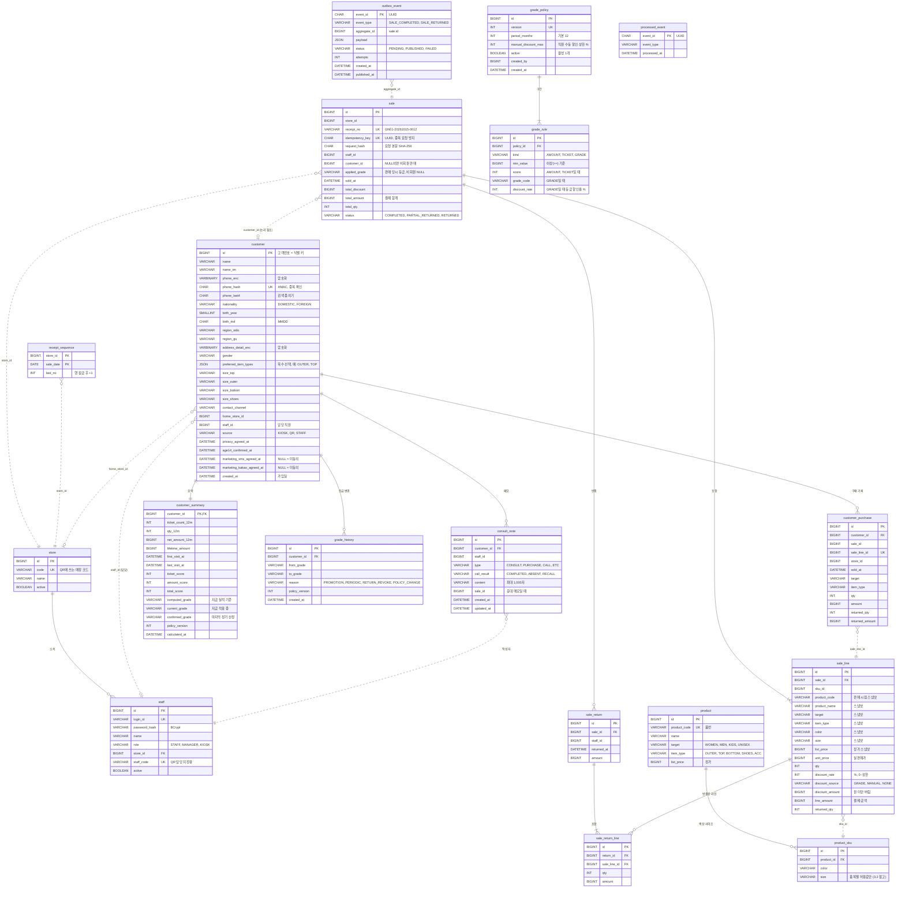

# 02. 데이터 모델 (ERD)

> 기준 문서: [01-requirements.md](01-requirements.md) · 작성일: 2026-10-15 · 상태: **확정** (2026-10-15 검토 완료. 이후 변경은 decisions.md에 기록)
> 변경: 2026-10-15 API 설계 반영 — `sale.idempotency_key`·`request_hash`(ADR-006), `customer.created_at`, outbox 순서 보장 인덱스(ADR-007). `02-erd.png`는 아직 이전 그림이다.
> DB: MariaDB · 금액은 원 단위 `BIGINT` · 시각은 `DATETIME(6)` · enum은 `VARCHAR(20)` 문자열로 저장

## 1. 한눈에 보기

테이블은 4개 모듈에 18개다. 핵심 규칙은 두 가지다.

1. **모듈끼리는 외래키(FK)를 걸지 않고 ID만 들고 있는다.** 같은 모듈 안에서만 FK를 쓴다.
2. **고객 모듈은 판매 테이블을 직접 조인하지 않는다.** 판매 이벤트로 받은 데이터를 자기 테이블(`customer_purchase`)에 쌓아 쓴다.

| 모듈 | 테이블 | 역할 |
| --- | --- | --- |
| common | `store`, `staff` | 매장, 직원·키오스크 계정 |
| product | `product`, `product_sku` | 상품(품번)과 색상·사이즈 단위 SKU |
| sales | `sale`, `sale_line`, `sale_return`, `sale_return_line`, `receipt_sequence`, `outbox_event` | 판매·반품 원본, 영수증 번호 채번, 발행할 이벤트 |
| customer | `customer`, `customer_purchase`, `customer_summary`, `grade_policy`, `grade_rule`, `grade_history`, `consult_note`, `processed_event` | 고객, 구매 기록(이벤트로 받은 것), 등급, 메모 |

## 2. ERD

실선은 같은 모듈 안의 FK, 점선은 다른 모듈의 ID를 들고만 있는 논리 참조다.

## 3. 모듈별 설명

### 3.1 common: `store`, `staff`

- `staff.role`에 `KIOSK`를 둔다. 매장 iPad는 매장별 KIOSK 계정으로 로그인하고, 이 역할은 고객 등록 API만 호출할 수 있다 (REG-02, NFR-04a).
- `store.code`와 `staff.staff_code`가 QR 링크에 들어간다 (`/join?store=GN01&staff=S017`). 내부 ID를 노출하지 않기 위해 별도 코드를 둔다.

### 3.2 product: `product`, `product_sku`

- 패션 상품은 "품번 1개 = 여러 색상 × 사이즈"라서 품번(`product`)과 판매 단위(`product_sku`)를 나눈다.
- 더미 데이터로만 채운다. 등록 화면은 없다 (PRD-01).
- 분류는 특정 브랜드가 아닌 보편적인 두 축으로 나눈다.

| 축 | 컬럼 | 값 |
| --- | --- | --- |
| 대상 | `target` | WOMEN(여성), MEN(남성), KIDS(아동), UNISEX(공용) |
| 품목 | `item_type` | OUTER(아우터), TOP(상의), BOTTOM(하의), SHOES(신발), ACC(액세서리) |

- 사이즈는 품목마다 허용값이 다르다. DB 테이블 대신 코드의 enum으로 두고, 상품·고객 저장 시 검증한다.

| 품목 | 허용 사이즈 |
| --- | --- |
| TOP | XS, S, M, L, XL, XXL |
| OUTER (여성) | 85, 90, 95, 100, 105 (화면 표시: 85(44), 90(55), 95(66), 100(77), 105(88)) |
| OUTER (남성·공용) | 95, 100, 105, 110, 115 |
| BOTTOM (여성) | 24, 26, 28, 30, 32 |
| BOTTOM (남성) | 28, 30, 32, 34, 36, 38 |
| SHOES | 220 ~ 280, 5 단위 (13개) |
| ACC | FREE |
| KIDS 상품 (의류) | 4, 6, 8, 10 (세) |

아동 신발은 MVP에서 다루지 않는다. 성별이 나뉘는 품목(아우터, 하의)은 상품의 `target`에 맞는 목록을 쓰고, 고객 프로필에서는 고객 성별에 맞는 목록을 보여준다.

### 3.3 sales: `sale`, `sale_line`, `sale_return`, `sale_return_line`, `receipt_sequence`, `outbox_event`

- **티켓 = `sale` 1행**(영수증 1장). BR-02.
- `sale_line`은 상품 정보를 **판매 시점 값으로 복사**(스냅샷)해 둔다. 나중에 상품명이나 카테고리가 바뀌어도 과거 영수증은 그대로여야 하기 때문이다.
- 반품은 원 판매를 고치지 않고 `sale_return`으로 따로 남긴다. `sale_line.returned_qty`와 `sale.status`는 조회 편의를 위한 값이다.
- **할인은 라인 단위로 저장한다** (BR-10). 쿠폰은 쓰지 않는다.
  - 결제 금액 = 실판매가 × 수량 − 할인 금액. 할인 금액 = 실판매가 × 수량 × 할인율, 원 미만 버림.
  - 회원 판매: 고객의 `current_grade` 할인율이 라인마다 자동으로 채워진다(`GRADE`). 직원이 바꾸면 `MANUAL`, 상한은 `grade_policy.manual_discount_max`.
  - 비회원 판매: 할인 불가(`NONE`, 0%). 할인을 받으려면 먼저 고객등록을 해야 한다.
  - 할인이 라인별이라 부분 반품 환불액은 그 라인의 결제 금액에서 바로 계산된다.
  - `sale.applied_grade`에 판매 당시 등급을 남긴다. 이번 판매로 승급해도 할인은 판매 전 등급 기준이다.
- **영수증 번호** = `매장코드-판매일자-순번4자리` (예: `GN01-20261015-0012`). `receipt_sequence`에서 (매장, 날짜) 행을 잠그고(`SELECT … FOR UPDATE`) 1 올린 값을 쓴다. 같은 매장에서 두 직원이 동시에 판매해도 번호가 겹치지 않는다. `sale.receipt_no` UNIQUE가 마지막 안전장치다.
- **중복 요청 방지**: `sale.idempotency_key`(UNIQUE)에 화면이 만든 UUID를 저장한다. 같은 키가 다시 오면 저장된 판매로 응답을 다시 만든다. `request_hash`가 다르면 같은 키로 다른 내용을 보낸 것이므로 거절한다. 두 요청이 동시에 와도 UNIQUE 제약이 하나만 남긴다 (ADR-006).
- `outbox_event`: 판매·반품을 저장하는 **같은 트랜잭션**에서 이벤트 행을 넣는다. 발행기가 `PENDING`을 읽어 고객 모듈에 전달하고 `PUBLISHED`로 바꾼다. 실패하면 `attempts`를 올리고 재시도하며, 10회를 넘으면 `FAILED`로 둔다 (BR-06).
  - 같은 판매(`aggregate_id`)의 이벤트는 `created_at` 순서대로 처리한다. 앞 이벤트가 `PUBLISHED`가 아니면 뒤 이벤트는 건너뛰고 다음 주기에 다시 본다 (ADR-007).

### 3.4 customer

| 테이블 | 설명 |
| --- | --- |
| `customer` | 고객 원본. 식별 키는 `id`(고객번호). 전화번호와 상세주소는 암호화 컬럼, 중복 확인은 `phone_hash`(UNIQUE) |
| `customer_purchase` | 판매 이벤트로 받은 **라인 단위 구매 기록**. 등급 집계와 콜리스트의 '구매 카테고리' 필터에 쓴다. `sale_line_id` UNIQUE로 같은 라인이 두 번 쌓이지 않는다. 상품명·색상·사이즈는 없으므로 화면의 구매이력(CUS-03)은 sales 모듈이 판매 테이블로 제공한다 |
| `customer_summary` | 고객당 1행의 **조회용 요약**. 검색 목록, 상세, 콜리스트가 집계 쿼리 없이 이 테이블만 읽는다 |
| `grade_policy` / `grade_rule` | 등급 기준. 수정하면 기존 행을 고치지 않고 **새 버전을 만든다**. 어느 기준으로 등급이 나왔는지 추적할 수 있다 |
| `grade_history` | 등급이 바뀔 때마다 1행. 사유 4종 (GRD-06) |
| `consult_note` | 상담·구매·연락 메모. 응대 메모는 `sale_id`로 판매와 연결 |
| `processed_event` | 처리한 이벤트 ID. 같은 이벤트가 다시 와도 이 테이블에 있으면 건너뛴다 (멱등, NFR-03) |

**등급 컬럼이 3개인 이유** (`customer_summary`)

| 컬럼 | 뜻 | 언제 바뀌나 |
| --- | --- | --- |
| `computed_grade` | 지금 실적(최근 12개월)으로 계산한 등급 | 판매·반품 이벤트, 매일 실적 갱신, 정기 산정, 기준 변경 |
| `current_grade` | 지금 고객에게 적용 중인 등급 | 즉시 승급, 반품 승급 취소, 정기 산정 |
| `confirmed_grade` | 마지막 정기 산정에서 확정된 등급 | 매월 정기 산정 |

규칙(BR-05)을 컬럼으로 옮기면 이렇게 된다.

- 판매 이벤트: `computed > current`이면 `current = computed` (즉시 승급)
- 반품 이벤트: `current = max(computed, confirmed)` (승급 취소, 단 확정 등급 아래로는 안 내려감)
- 정기 산정: `current = confirmed = computed` (이때만 강등)
- 매일 실적 갱신: `computed`와 12개월 집계만 다시 계산한다. 시간이 지나면 실적은 줄기만 하므로 `current`는 바뀌지 않는다 (ADR-008)

등급 비교(`>`, `max`)는 등급 코드의 문자 순서가 아니라 기준의 등급 컷 점수(`grade_rule.min_value`, kind=GRADE) 순서로 한다. `*_12m` 컬럼은 기본 기간 기준의 이름이고, 실제 기간은 `grade_policy.period_months`를 따른다 (NFR-10의 36개월 테스트에서도 같은 컬럼을 쓴다).

## 4. 인덱스

| 테이블 | 인덱스 | 쓰는 곳 |
| --- | --- | --- |
| `customer` | `(name)`, `(name, phone_last4)` | 고객명 앞부분 일치 검색, 뒷자리로 좁히기 (CUS-01). 중간 일치(`%하늘%`)는 인덱스를 못 쓰지만 고객 5천 명 규모라 전체 스캔을 허용하고 NFR-01로 측정한다 |
| `customer` | `UNIQUE(phone_hash)` | 중복 등록 방지 (REG-05) |
| `customer` | `(staff_id)` | 콜리스트 '내 담당' |
| `customer_summary` | `(current_grade, last_visit_at)` | 콜리스트 등급·미방문 필터 (CAL-01) |
| `customer_purchase` | `(customer_id, sold_at)` | 최근 12개월 집계 |
| `customer_purchase` | `(item_type, customer_id)`, `(target, customer_id)` | 콜리스트 구매 품목·대상 필터 |
| `customer_purchase` | `UNIQUE(sale_line_id)` | 같은 라인 중복 적재 방지 |
| `sale` | `UNIQUE(receipt_no)` | 영수증 번호 중복 방지 (번호에 매장코드 포함) |
| `sale` | `(store_id, sold_at)` | 판매 내역 (SAL-05) |
| `sale` | `UNIQUE(idempotency_key)` | 같은 판매 요청 중복 저장 방지 (ADR-006) |
| `sale` | `(customer_id, sold_at)` | 고객 상세의 구매이력 (CUS-03, sales 모듈의 조회) |
| `outbox_event` | `(status, created_at)` | 발행기가 PENDING을 오래된 순으로 읽기 |
| `outbox_event` | `(aggregate_id, created_at)` | 같은 판매의 앞 이벤트 처리 여부 확인 (ADR-007) |
| `consult_note` | `(customer_id, created_at)` | 메모 목록 최신순 |

## 5. 설계 결정과 이유

| # | 결정 | 이유 | 버린 대안 |
| --- | --- | --- | --- |
| 1 | 모듈 간 FK 없이 ID로만 참조 | 모듈 경계를 DB에서도 지킨다. 나중에 모듈을 서비스로 떼어낼 때 FK부터 풀 필요가 없다 | 모든 테이블에 FK: 편하지만 모듈이 DB로 묶인다 |
| 2 | 고객 모듈은 `customer_purchase`(이벤트로 받은 사본)를 쓴다 | 판매 테이블 구조가 바뀌어도 고객 모듈이 깨지지 않는다. 판매 → 고객 흐름이 이벤트 하나로만 연결된다 | 판매 테이블 직접 조인: 쉽지만 결합도가 높다 |
| 3 | 요약 테이블 `customer_summary` | 검색·콜리스트마다 12개월 집계를 돌리지 않는다. 엑셀의 느린 SUMIFS 문제를 푸는 지점 | 조회 때마다 집계: 고객이 늘면 느려진다 |
| 4 | 판매 라인에 상품 정보 스냅샷 | 과거 영수증은 판매 당시 값이어야 한다 | 상품 테이블 조인: 상품이 바뀌면 과거 기록이 바뀐다 |
| 5 | 반품은 별도 테이블, 원 판매는 수정하지 않음 | 언제 무엇이 반품됐는지 이력이 남는다 | 판매 행 수정·삭제: 이력이 사라진다 |
| 6 | 등급 기준은 버전으로 쌓는다 | "이 고객은 왜 B인가"를 기준 버전으로 설명할 수 있다 | 기준 행 덮어쓰기: 과거 근거가 사라진다 |
| 7 | 등급 3컬럼(computed / current / confirmed) | '승급 즉시, 강등 정기' 규칙을 조건문 3줄로 표현할 수 있다 | 등급 1컬럼: 반품 취소의 하한을 알 수 없다 |
| 8 | outbox + `processed_event` | 판매는 됐는데 이벤트가 사라지는 일, 이벤트가 두 번 처리되는 일을 둘 다 막는다 | 메모리 이벤트만: 서버가 죽으면 이벤트가 사라진다 |
| 9 | 쿠폰 대신 등급 할인, 라인 단위 저장 | CRM 등급 자체가 혜택이 된다. 테이블이 늘지 않고, 부분 반품 계산이 단순하다 | 쿠폰 발급·사용: 새 도메인이라 10~15시간 추가 |
| 10 | 멱등 키를 `sale` 컬럼으로 | 판매 1건 = 키 1개라 테이블이 필요 없고, 응답은 저장된 판매로 다시 만든다 | 별도 멱등 키 테이블: 응답 본문까지 저장해야 해 무겁다 |

## 6. 확인 필요

- [ ] Refresh 토큰 저장 방식: MVP는 서버에 저장하지 않는 방식으로 시작. 로그아웃 강제가 필요하면 테이블 추가
