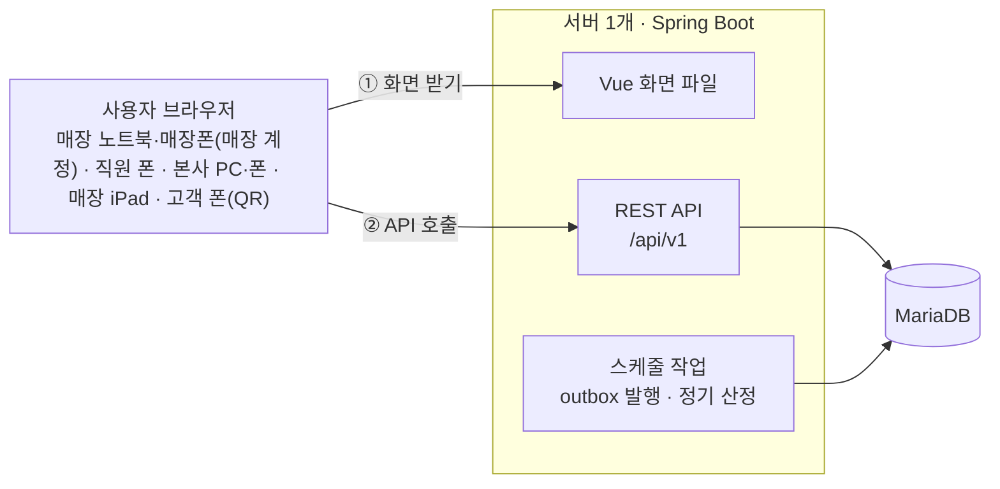
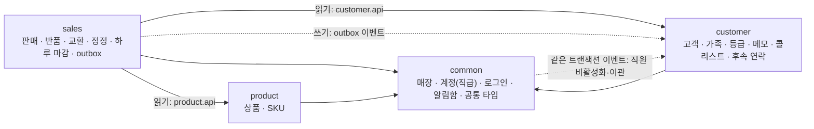
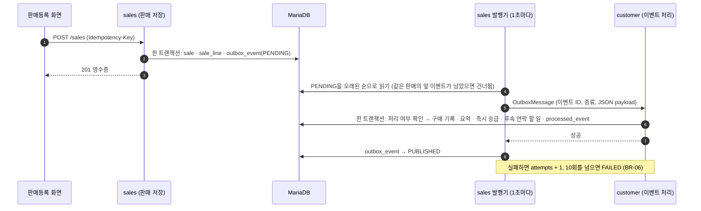

# 04. 시스템 아키텍처

> 기준 문서: [01-requirements.md](01-requirements.md), [02-erd.md](02-erd.md), [03-api.md](03-api.md), [decisions.md](decisions.md) · 작성일: 2026-10-17 · 상태: 초안
> 여러 문서에 흩어져 있던 구조 결정(ADR-001~003, 007, 008, 010)을 한곳에 모으고, 코드를 쓰기 전에 필요한 세 가지(ADR-011~013)를 정한다.
> 2026-10-23 요구사항 점검 반영: 역할·기기(2장), 공통 → 고객 동기 이벤트(3장), 교환·정정 이벤트(5장), 정기 산정 임시/확정(6장), 보안(7장) (ADR-021~029).

## 1. 한눈에 보기

- 웹사이트 1개, 서버 1개, DB 1개 (ADR-001). Spring Boot 서버가 API와 Vue 화면 파일을 함께 내보낸다 (ADR-013).
- 코드 안에서 판매(`sales`), 고객관리(`customer`), 상품(`product`), 공통(`common`) 4개 모듈로 나눈다.
- 판매 → 고객관리는 outbox 이벤트로만 연결한다 (ADR-002).



## 2. 사용자와 접근

| 사용자 | 기기 | 로그인 | 주로 쓰는 화면 |
| --- | --- | --- | --- |
| 매장 (STORE, 매장 계정) | 매장 노트북, 매장폰 | 매장마다 1개, 매장 직원 모두가 씀. 계속 로그인 상태 | 판매 기록(판매 사원 선택), 판매 내역·반품·교환·정정·마감, 고객 등록·검색·상세, 오늘 할 일·콜리스트(매장 전체) |
| 직원 (MANAGER·SENIOR·JUNIOR·STAFF) | 개인 폰 (웹앱) | 개인 계정, 14일 유지 | 오늘 할 일(내 할 일), 고객 상세, 콜리스트(내 담당), 메모, 알림함. 판매 기록은 못 한다 |
| 본사 (HQ) | PC, 폰 | 개인 계정, 소속 매장 없음 | 매장 목록 → 매장 상세(직원·판매 정정·마감·매장 계정), 등급 기준, 후속 연락 설정. 판매 기록은 못 한다 |
| 매장 iPad (KIOSK) | iPad | 매장별 키오스크 계정, 계속 로그인 상태 | 고객 등록 폼만 |
| 고객 | 본인 폰 | 없음 | QR 고객 등록 폼만 (요청 수 제한) |

- 화면은 Vue 앱 1개다. 역할과 화면 너비에 따라 PC 레이아웃(매장 계정 노트북, 본사)과 폰 레이아웃(직원, 매장폰)을 나눈다 (ADR-013).
- 권한의 세부는 01-requirements.md 2장, 03-api.md 2장을 따른다 (ADR-023).

## 3. 모듈 구조와 의존 방향



| 방향 | 방법 | 예 |
| --- | --- | --- |
| 판매 → 상품 (읽기) | `product.api`의 인터페이스 호출 | 등록 상품을 고른 라인의 SKU·정가 조회 (상품 등록은 선택) |
| 판매 → 고객 (읽기) | `customer.api`의 인터페이스 호출 | 현재 등급·할인율(안내용), 착용자가 그 고객의 가족인지 |
| 판매 → 고객 (쓰기) | outbox 이벤트만 | 구매 기록, 등급 반영 (5장) |
| 고객 → 판매 | 부르지 않는다 | 순환을 막는다. 구매이력 화면(CUS-03)은 판매 모듈이 제공한다 |
| 공통 → 고객 (쓰기) | 같은 트랜잭션의 Spring 이벤트 (`StaffDeactivated`, `StaffHandover`) | 직원 비활성화·이관 때 담당 고객과 열린 할 일 옮기기. 사람이 화면에서 하는 드문 관리 작업이라 한 트랜잭션으로 끝낸다 (ADR-024) |
| 모든 모듈 → 공통 | 자유롭게 | 로그인 사용자, 매장·직원, 에러 형식, 직원 알림 보내기 |

- 모듈끼리는 DB에서도 FK 없이 ID만 들고 있고, 고객 모듈은 판매 테이블을 조인하지 않는다 (ADR-003).
- 다른 모듈의 `controller`, `service`, `repository`, `domain`은 import하지 않는다. 다른 모듈에서 쓸 수 있는 것은 `api`와 `common`뿐이다 (ADR-012).

## 4. 패키지 구조

```
com.crmpos
├─ sales
│  ├─ controller   REST 컨트롤러, 요청·응답 record
│  ├─ service      업무 흐름, 트랜잭션
│  ├─ domain       엔티티, enum, 업무 규칙 (환불 금액 계산 등)
│  ├─ repository   Spring Data JPA 리포지토리(쓰기), MyBatis 조회 매퍼 `…QueryMapper` (ADR-018)
│  └─ event        outbox 기록과 발행기
├─ customer
│  ├─ api          다른 모듈이 읽을 수 있는 창구 (인터페이스 + record)
│  ├─ controller / service / domain / repository
│  └─ event        판매 이벤트 처리 (processed_event로 중복 방지)
├─ product
│  ├─ api          판매 모듈이 상품을 읽는 창구
│  └─ controller / service / domain / repository   (service에 엑셀 폼 만들기·가져오기, ADR-015)
└─ common
   ├─ domain       매장(store), 계정(staff: 본사·매장 계정·직원·키오스크), 직원 알림 엔티티
   ├─ type         여러 모듈이 같이 쓰는 enum (등급 코드, 대상, 품목, 성별)
   ├─ security     로그인, JWT, 역할 권한 (예정)
   ├─ error        공통 에러 응답 (03-api.md 1장, 예정)
   ├─ notification 직원 알림 인터페이스와 "앱 안 알림함" 구현 (ADR-029, 예정)
   └─ event        모듈 간 이벤트 전달 형식 `OutboxMessage`, 직원 비활성화·이관 이벤트 (예정)
```

- 계층 방향은 `controller → service → repository · domain`이다. `domain`은 다른 계층을 모른다.
- `api` 패키지에는 인터페이스와 반환 record만 둔다. 구현은 그 모듈의 `service`에 둔다.
- MyBatis SQL 파일은 `resources/mappers/{모듈}/`에 두고 자기 모듈 테이블만 쓴다. SQL 경계 테스트와 import 경계 테스트(ArchUnit)가 이 규칙을 검사한다 (ADR-018).
- 요청·응답은 record로 만들고, 엔티티를 응답으로 그대로 내보내지 않는다 (CLAUDE.md DTO 규칙).
- 한 모듈의 패키지가 너무 커지면 그 모듈 안에서 기능별 하위 패키지(예: `customer.grade`)로 나눌 수 있다.

## 5. 판매 → 고객관리 이벤트 흐름



- 판매 저장과 이벤트 기록이 한 트랜잭션이라, 판매는 됐는데 이벤트가 사라지는 일이 없다 (ADR-002).
- 발행기는 outbox 행을 공통 형식 `OutboxMessage`로 Spring 이벤트에 실어 보낸다. 고객 모듈은 이벤트 종류로 골라 받고, JSON을 자기 record로 읽는다. 판매 모듈은 고객 모듈 코드를 모른다 (ADR-012).
- 같은 이벤트가 두 번 와도 `processed_event`에 있으면 건너뛴다 (NFR-03). 같은 판매의 이벤트는 발생 순서대로 처리한다 (ADR-007).
- 비회원 판매도 이벤트는 발행하고, 고객 모듈은 처리 기록만 남긴다 (03-api.md 6장).
- 교환은 원 판매의 `SALE_RETURNED`(kind=EXCHANGE)와 새 판매의 `SALE_COMPLETED`(kind=EXCHANGE), 정정은 `SALE_RETURNED`(kind=VOID)와 `SALE_COMPLETED`(kind=CORRECTION)를 같은 트랜잭션에서 outbox에 쓴다. 새 판매의 이벤트도 `aggregate_id`에 원 판매 ID를 넣어 순서대로 처리된다. 고객 모듈은 이 이벤트로 구매 건과 티켓을 정한다 (ADR-022·026).
- 고객 모듈은 같은 처리 안에서 후속 연락 할 일(2일·2주·2달)도 만든다. "오늘 할 일"은 만기일로 조회하므로 따로 도는 스케줄 작업은 없다 (BR-14, ADR-016).

## 6. 스케줄 작업

| 작업 | 주기 | 하는 일 | 근거 |
| --- | --- | --- | --- |
| outbox 발행기 | 1초마다 | PENDING 이벤트를 고객 모듈에 전달, 실패하면 재시도 | BR-06, ADR-007 |
| 정기 산정 | 매년 6월 1일 새벽 + 6월 중 서버가 켜질 때 1회, 수동 실행 API | 막 끝난 시즌 실적으로 다음 시즌 등급(6월은 임시)을 정하고, 집계를 새 시즌 기준으로 다시 계산. `current = max(confirmed, computed)`라 몇 번 돌아도 결과가 같다 | GRD-05, ADR-020·021 |

- 시즌 누적 실적은 판매·반품 이벤트 때만 바뀌므로 매일 도는 재계산 작업은 없다 (ADR-020, ADR-008 대체).
- 서버가 1개라 같은 작업이 동시에 두 번 도는 일이 없으므로 분산 잠금(ShedLock 등)은 쓰지 않는다.
- 잠드는 무료 서버가 6월 1일 새벽을 놓쳐도 6월 중 서버가 켜질 때 정기 산정이 돈다. 재실행이 안전해 실행 기록은 두지 않는다 (ADR-021).
- 7월 1일 확정과 자정의 하루 마감 자동 잠금은 날짜로 판단하므로 따로 도는 작업이 없다 (ADR-021·026).

## 7. 보안 구조

- **로그인**: 아이디·비밀번호(BCrypt) → JWT Access 30분 + Refresh 14일. 재발급 때 Refresh도 새로 줘서 매일 쓰는 기기는 계속 로그인 상태다. 요청마다 Spring Security 필터가 토큰을 검사하고, 계정이 활성인지와 `tokens_valid_after`(로그인 기준 시각)를 확인한다. 비활성화하면 그 순간부터 막힌다 (ADR-025).
- **로그인 없이 열리는 곳**: `/public/**`(QR 등록, 사이즈 목록), `/auth/login`, `/auth/refresh`, Vue 화면 파일.
- **역할 권한**: HQ · STORE · MANAGER·SENIOR·JUNIOR·STAFF · KIOSK (01-requirements.md 2장, 03-api.md 2장, ADR-023). 접근 제한 기능은 HQ만, 판매 기록은 STORE만 한다. 판매 매장은 요청이 아니라 토큰의 소속 매장으로 정한다 (`STORE_REQUIRED`). 매장 단위 API는 `/stores/{storeId}/...`이고 STORE는 자기 매장만 쓴다.
- **공용 기기**: 매장 계정은 매장 직원 모두가 쓰므로, 판매·연락·메모마다 직원을 지정해 사람 단위 기록을 남긴다. 직원이 퇴사하면 비활성화와 함께 매장 계정 비밀번호를 새로 정한다 (BR-15).
- **QR 공개 API**: IP당 분당 5회. 프록시 뒤에서는 신뢰하는 프록시의 `X-Forwarded-For`로 IP를 판별한다 (NFR-04a).
- **개인정보**: 전화번호·상세주소는 암호화 저장, 중복 확인은 HMAC 해시, 목록에는 뒷자리 4개만 보인다 (NFR-04, NFR-05).
- **로그**: 로그에는 ID만 남긴다. 전화·주소가 든 record는 `toString()`을 가리고, 요청 본문과 SQL 바인딩 값은 배포 환경에서 찍지 않는다 (NFR-04b).
- **화면**: 브라우저 저장소에는 토큰만 두고 고객 데이터는 저장하지 않는다 (NFR-04c).
- **비밀 값**: DB 비밀번호, 암호화 키, HMAC 키, JWT 시크릿은 환경변수로만 받는다. 로컬은 레포 맨 위의 `.env`(커밋 안 함)를 읽는다 (NFR-06).

## 8. 실행 환경

### 8.1 로컬 개발

```
.env (레포 맨 위, 커밋 안 함)
 ├─▶ docker compose ─▶ MariaDB 11 (포트 3316)
 └─▶ Spring Boot (./gradlew bootRun, 포트 8080) ─▶ MariaDB

Vue 개발 서버 (Vite) ── /api 요청 ──▶ Spring Boot 8080   (화면 작업 때)
```

- 테이블은 `schema.sql`로 만들고, Hibernate는 엔티티와 테이블이 맞는지 검사만 한다 (ADR-010).
- 프로필: 기본(로컬), `seed`(과거 판매 시각 허용과 더미 판매 생성기, ING-01), 배포용(이름은 배포 확인 때 정한다).

### 8.2 배포

- Vue를 빌드한 파일을 Spring Boot jar의 정적 파일로 넣어 한 번에 배포한다 (ADR-013). 앱은 1개이고 역할·화면 너비로 PC·폰 레이아웃을 나눈다 (2장).
- 화면 주소(예: `/customers/1024`)로 바로 들어와도 `index.html`을 돌려준다. `/api/**`, `/actuator/**`, `/swagger-ui/**`는 그대로 둔다.
- 무료 호스팅 1곳에 서버와 DB를 둔다. 어디에 올릴지는 실제로 배포해 보고 정한다 (B0-4, 01-requirements.md 11장).

### 8.3 테스트

- **방식**: TDD 안쪽부터(Repository → Service → Controller), 테스트 층은 엔티티·Repository·Service·Controller·통합이다. 이름은 `@DisplayName` 한글 + `should_동작_when_조건` (ADR-017).
- **단위 테스트**: 등급 산정, 환불 금액, 결제 금액 기본값, 상품 엑셀 검증, 전화번호 정규화, 이벤트 처리 규칙 (NFR-09). Service는 `@Mock`으로 DB 없이 확인한다.
- **통합 테스트**: `@SpringBootTest` + MockMvc로 Controller부터 DB까지 실행한다. DB는 Testcontainers로 띄운 MariaDB 11이고 H2는 쓰지 않는다. 이벤트 중복·순서, 동시 판매 시 영수증 번호, 중복 요청 방지를 확인한다 (NFR-03, NFR-03a).
- **경계 테스트**: MyBatis SQL이 다른 모듈 테이블을 쓰는지, 다른 모듈 코드를 import하는지 검사한다 (ADR-018).

## 9. 기술 스택

| 구분 | 사용 | 상태 |
| --- | --- | --- |
| 언어 | Java 21 | 사용 중 |
| 백엔드 | Spring Boot 4.1 (Web MVC, Data JPA, Validation, Actuator), Lombok | 사용 중 |
| DB | MariaDB 11 | 사용 중 |
| 빌드 | Gradle 9 (Groovy) | 사용 중 |
| 로컬 실행 | Docker Compose | 사용 중 |
| 인증 | Spring Security, jjwt | 예정 (1주 차) |
| API 문서 | springdoc-openapi | 예정 (NFR-12) |
| 엑셀 | Apache POI | 예정 (상품 엑셀 폼·가져오기, ADR-015) |
| 조회 SQL | MyBatis (`mybatis-spring-boot-starter` 4.1) | 예정 (목록·검색·집계 조회, ADR-018) |
| QR | ZXing | 예정 (매장·직원 QR 이미지, ADR-019) |
| 테스트 | JUnit 5, Mockito, MockMvc, Testcontainers (MariaDB), ArchUnit | JUnit 5 사용 중, 나머지 예정 (ADR-017·018) |
| 프론트엔드 | Vue 3, Vite | 예정 |

## 10. 관련 결정

| ADR | 내용 |
| --- | --- |
| ADR-001 | 모듈러 모놀리스: 웹사이트·서버·DB 각 1개 |
| ADR-002 | 판매 → 고객관리는 outbox 이벤트 |
| ADR-003 | 모듈 간 FK 없음, 고객 모듈은 구매 기록 사본 사용 |
| ADR-007 | 같은 판매의 이벤트는 순서대로 처리 |
| ADR-008 | 고객 요약을 매일 새벽 다시 계산 (**대체됨**: ADR-020) |
| ADR-010 | 테이블은 `schema.sql`로, Hibernate는 검사만 |
| ADR-011 | 모듈 안은 계층별 패키지 |
| ADR-012 | 모듈 간 읽기는 `api` 창구, 쓰기는 이벤트 |
| ADR-013 | Vue 화면은 Spring Boot가 같이 내보낸다 |
| ADR-014 | 판매 금액은 실제 결제 금액을 기록, 등급 할인은 안내 |
| ADR-015 | 상품 엑셀 폼과 가져오기는 Apache POI |
| ADR-016 | 후속 연락은 판매 이벤트 때 할 일 행을 만들어 둔다 |
| ADR-017 | 테스트는 CONK 방식, DB는 Testcontainers MariaDB |
| ADR-018 | 조회는 MyBatis, 쓰기는 JPA, 모듈 경계는 테스트로 검사 |
| ADR-019 | 전화번호 정규화·요청 수 제한·QR·기본 데이터 |
| ADR-020 | 등급 실적은 시즌 단위 |
| ADR-021 | 정기 산정은 6월 한 달 임시, 7월 1일부터 확정 |
| ADR-022 | 티켓은 구매 건 기준, 교환은 구매 건에 붙인다 |
| ADR-023 | 역할 체계: 본사·매장 계정·직급·키오스크 |
| ADR-024 | 직원 비활성화·이관은 같은 트랜잭션의 Spring 이벤트 |
| ADR-025 | 로그인 기준 시각과 요청마다 계정 확인 |
| ADR-026 | 판매 정정은 기록 취소 + 다시 기록, 하루 마감으로 잠금 |
| ADR-027 | 등급 기준은 다음 정기 산정부터, 할인율은 따로 |
| ADR-028 | 여러 브랜드는 나중에 `brand_id` 논리 분리 |
| ADR-029 | 직원 알림 인터페이스와 연락 채널 (나중 기능 자리) |
