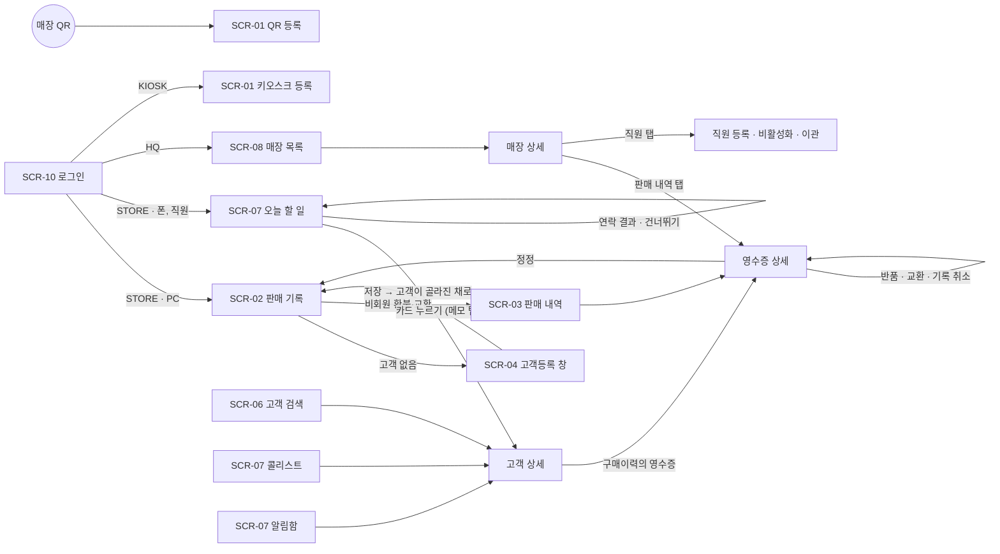

# 05. 화면설계서

> 기준 문서: [01-requirements.md](01-requirements.md) (2장 계정, 3장 기능, 6장 화면 목록), [03-api.md](03-api.md) (7장 화면 ↔ API), [dev-plan.md](dev-plan.md) 3장 (F 작업) · 작성일: 2026-10-30 · 정함: 2026-11-04 · 상태: **정함** (피그마와 8단계 개발 중에 바뀌면 고친다)
> WBS 4단계. 화면 흐름(4-1)과 화면별 설계(4-2)는 사용자 인터뷰로 정했다. 질문과 답은 [screen-interview.md](screen-interview.md)에 있고, 이 문서의 `(R1)`, `(S9)` 같은 표시가 그 번호다. 인터뷰에서 묻지 않은 것은 사용자가 맡겨(2026-11-04) 추천안으로 정했고, `(W1)`처럼 표시했다.
> 와이어프레임(4-3)은 사용자가 피그마로 화면 전부를 그린다 (L3). 그릴 프레임 목록은 4장에 있다.
> 범위: MVP 화면 10개 (01 6장). '다음' 기능은 끼울 자리만 적는다. 화면에 나오는 이름·번호는 모두 가상 데이터다 (NFR-07).

## 1. 공통 규칙

### 1.1 레이아웃

| 레이아웃 | 언제 | 모양 |
| --- | --- | --- |
| PC | 화면 폭 768px 이상 (매장 노트북 1366×768 기준, 본사 PC) (W12) | 위 막대 한 줄: 왼쪽 서비스 이름 `CRM pos` · 가운데 메뉴 · 오른쪽 로그인 계정과 계정 메뉴 (L1). 본문 최대 폭 1280px |
| 폰 | 화면 폭 768px 미만 (360px 기준, 직원 폰·매장폰·본사 폰) | 위 막대: 화면 이름 · 오른쪽 로그인 계정(줄임). 아래 탭 4개 (L2). 터치 영역 44px 이상 |
| 등록 전용 | 키오스크(iPad 세로 768×1024), QR 공개 페이지(폰 360px) | 메뉴 없음. 위에 매장 이름만. 큰 입력 칸 |

- 같은 매장 계정이라도 화면 폭으로 첫 화면이 갈린다 (01 6장): PC면 판매 기록, 폰이면 오늘 할 일.
- 위 막대에는 로그인한 계정을 항상 보여준다 (AUTH-03): 매장 계정은 `강남점 · 매장 계정`, 직원은 `이지은 · 시니어`, 본사는 `최유나 · 본사`.
- PC 화면을 폰 폭으로 열면(예: 매장폰에서 판매 기록) 칸을 한 줄로 쌓아 보여준다 (R4). 폰 전용 배치는 오늘 할 일·콜리스트·고객 검색·상세·알림함만 따로 만든다.

### 1.2 계정별 화면 · 첫 화면 · 메뉴

| 화면 | 매장 계정 | 직원 (매니저~스태프) | 본사 | 키오스크 | 고객 (QR) |
| --- | --- | --- | --- | --- | --- |
| 로그인 | ● | ● | ● | ● | — |
| 판매 기록 (구매·환불·교환) | ● 노트북 기준, 매장폰도 (R4) | — | — | — | — |
| 판매 내역·영수증 (반품·정정·기록 취소·마감) | ● 자기 매장, 정정은 그날만 | — | ● 매장 상세 안. 마감 뒤 정정, 다시 열기 | — | — |
| 고객등록 (직원이 대신 입력) | ● | — | — | — | — |
| 고객 등록 폼 (고객이 직접 입력) | — | — | — | ● iPad | ● 폰 |
| 고객 검색·상세 | ● 수정, 가족, 연락 결과 | ◐ 보기, 메모, 연락 결과 (R1) | ● 보기, 수정 | — | — |
| 오늘 할 일 | ● 매장 전체, 연락 결과·완료·건너뛰기 | ● 내 할 일, 연락 결과·완료·건너뛰기 (R1) | — (R3) | — | — |
| 콜리스트 | ● 매장 공지용 | ● 내 담당 | ◐ 매장을 골라서 (R3) | — | — |
| 알림함 | — | ● | — | — | — |
| 상품 관리 | ● | — | ● | — | — |
| 매장 목록·상세 (직원, 마감, 매장 계정 비밀번호) | — | — | ● | — | — |
| 등급 기준·후속 연락 설정 | ◐ 보기만 | — | ● | — | — |
| 비밀번호 바꾸기 | — (본사가 다시 정해 줌) | ● | ● | — | — |

● 다 씀, ◐ 일부만. 매니저도 다른 직원과 같은 화면이다 (R2).

| 계정 | 첫 화면 | PC 메뉴 (위 막대) | 폰 아래 탭 (첫 탭 = 첫 화면) |
| --- | --- | --- | --- |
| 매장 계정 | PC: 판매 기록 · 폰: 오늘 할 일 | 판매 기록 · 판매 내역 · 고객 · 오늘 할 일 · 콜리스트 · 상품 · 기준 보기 | 오늘 할 일 · 콜리스트 · 고객 · 더보기(판매 기록, 판매 내역, 상품, 기준 보기) |
| 직원 | 오늘 할 일 (내 할 일) | 오늘 할 일 · 콜리스트 · 고객 · 알림함 | 오늘 할 일 · 콜리스트 · 고객 · 알림(배지) |
| 본사 | 매장 목록 | 매장 목록 · 고객 · 콜리스트 · 상품 · 설정 | 매장 목록 · 고객 · 콜리스트 · 더보기(상품, 설정) |
| 키오스크 | 키오스크 등록 | 없음 | 없음 |
| 고객 (로그인 없음) | QR 등록 | 없음 | 없음 |

- 고객 등록(직원 대리)은 고객 메뉴 안의 [고객 등록] 버튼과 판매 기록의 [새 고객 등록]에서 연다.
- 계정 메뉴(위 막대 오른쪽): 비밀번호 바꾸기·모든 기기에서 로그아웃(개인 계정만), 로그아웃(키오스크 빼고). 11단계(F13)에서 만든다.
- 그 계정의 메뉴에 없는 화면 주소로 들어오면 첫 화면으로 보낸다. 키오스크는 등록 화면 밖으로 나갈 수 없다 (REG-02).
- 11단계 전에는 로그인 화면이 없다. 8단계의 가짜 데이터 화면에서는 위 막대에 **개발용 계정 바꾸기**(가짜 `GET /me`)를 두어 계정별 화면을 확인하고, 11단계에서 지운다 (W13, ADR-032).

### 1.3 공통 컴포넌트 (F12)

| 컴포넌트 | 하는 일 | 쓰는 화면 |
| --- | --- | --- |
| 직원 고르기 | 그 매장의 활성 직원 **드롭다운**. 칸은 비어 있고, 열면 직전에 고른 직원이 맨 위에 있다 (S2·S9·W5). 매장 계정 자신은 목록에 없다. 직원 개인 계정에서는 칸이 없고 본인으로 남는다 (R1) | 판매 기록(판매 사원·처리 직원), 반품·교환·기록 취소 창(처리 직원), 연락 결과 창(연락한 직원), 메모 작성(작성 직원), 고객등록(담당 직원) |
| 고객 찾기 | 이름 입력 → Enter → 목록(이름, 뒷자리, 등급 배지, 마지막 방문, 담당 직원) → 클릭 또는 ↑↓ Enter. 결과가 없으면 "새 고객 등록" | 판매 기록, 고객 검색 |
| 상품 고르기 | 상품명·품번 검색 → 상품 → 색상 버튼 → 사이즈 버튼 → [담기] (S5). "직접 입력"으로 바꾸기. 이 화면에서 최근 고른 상품 5개 | 판매 기록, 교환 |
| 사이즈 선택 | 품목·대상(또는 성별)에 맞는 허용값만 버튼으로 (02 3.2). 여성 아우터는 `90(55)`처럼 표시 | 상품 등록, 고객 등록·수정, 가족 구성원, 직접 입력 |
| 저장 확인 창 | 저장할 내용 요약 + 질문 + [저장] [돌아가기]. Enter = 저장, Esc = 돌아가기 | 판매·환불·교환·정정·기록 취소·마감·비활성화 |
| 등급 배지 | `B` 같은 코드를 색과 함께. 6월 임시면 `B 임시` (GRD-05). 이름은 "매장 단골 등급" | 고객 목록·상세, 판매 기록, 오늘 할 일, 콜리스트 |
| 마스킹 번호 | `****-4821` (목록) | 고객 목록, 오늘 할 일, 콜리스트 |
| 에러 표시 | API 에러의 `message`를 위 띠로, `fieldErrors`는 그 칸 아래에 (1.5, W12) | 모든 화면 |

- 직전에 고른 직원, 최근 고른 상품은 화면 메모리(Pinia)에만 둔다. 새로고침하면 비운다 (S8). 브라우저 저장소에는 토큰만 둔다 (NFR-04c).

### 1.4 표시 규칙

| 대상 | 표시 |
| --- | --- |
| 금액 | `774,060원` (원 단위, 쉼표) |
| 날짜·시각 | 목록은 `10/15 14:03`, 상세는 `2026-10-15 14:03`. 오늘이면 `오늘 14:03` |
| 지난 날 | 마지막 방문 `128일 전`, 밀린 할 일 `3일 밀림` |
| 전화번호 | 목록은 `****-4821`, 상세만 전체 (NFR-05) |
| 등급 | `NORMAL` → 일반, `A`~`D`는 그대로. 화면 이름은 "매장 단골 등급" (BR-04) |
| 품목 `itemType` | `OUTER` 아우터 · `TOP` 상의 · `BOTTOM` 하의 · `SHOES` 신발 · `ACC` 액세서리 |
| 대상 `target` | `WOMEN` 여성 · `MEN` 남성 · `KIDS` 아동 · `UNISEX` 공용 |
| 판매 상태 | `COMPLETED` 정상 · `PARTIAL_RETURNED` 일부 반품 · `RETURNED` 전체 반품 · `VOIDED` 기록 취소 |
| 판매 종류 `kind` | `NORMAL` 구매 · `EXCHANGE` 교환 · `CORRECTION` 정정 |
| 메모 유형 | `CONSULT` 상담 · `PURCHASE` 구매 · `CALL` 연락 · `ETC` 기타 |
| 연락 결과 · 채널 | `COMPLETED` 통화 완료 · `ABSENT` 부재 · `RECALL` 재연락 / `CALL` 전화 · `SMS` 문자 · `KAKAO` 카톡 |
| 할 일 상태 | `OPEN` 할 일 · `DONE` 완료 · `SKIPPED` 건너뜀 · `CANCELLED` 취소 · `REPLACED` 새 구매로 바뀜 |
| 가족 관계 | `SPOUSE` 배우자 · `CHILD` 자녀 · `PARENT` 부모 · `OTHER` 기타 |

- "결제" 버튼은 없다. 결제는 매장 POS에서 끝났고 이 서비스는 기록만 한다 (SAL-01). 버튼 이름은 "저장", "기록"이다. 칸 이름 "결제 금액"은 쓴다.

### 1.5 저장 · 에러 · 빈 화면

**저장할 때**

- 저장 버튼은 요청 중에 끄고 "저장 중…"으로 바꾼다.
- 판매·환불·교환·정정·기록 취소는 화면(또는 창)을 열 때 요청 키(UUID)를 만든다 (BR-12). **저장에 성공했을 때만**(201, 또는 재전송에 대한 200) 새 키를 만든다. 네트워크 오류로 답을 못 받으면 같은 키로 다시 보내므로 다시 눌러도 한 건이다. 400·409처럼 저장되지 않은 실패 뒤에는 같은 키로 고쳐 보내도 된다 (W12).

**에러 응답 → 화면** (모든 화면 공통, 03 1장·5장)

| 응답 | 화면 |
| --- | --- |
| 400 `VALIDATION_FAILED` + `fieldErrors` | 그 칸 아래에 `reason`을 빨간 글씨로, 첫 번째 틀린 칸으로 이동 |
| 400 그 밖 (`INVALID_SIZE`, `PASSWORD_POLICY_VIOLATION` 등) | 관련 칸 아래 또는 위 띠에 `message` |
| 401 | 토큰 재발급 후 한 번 다시 요청, 그래도 401이면 로그인 화면 (F13). `AUTH_ACCOUNT_DISABLED`는 "사용할 수 없는 계정입니다. 본사에 문의하세요" |
| 403 | 위 띠 "이 계정으로는 할 수 없는 일입니다" |
| 404 | 화면 본문에 "찾을 수 없습니다" + 목록으로 가기 |
| 409 | 위 띠에 `message` + 아래 표의 동작 |
| 429 | "잠시 후 다시 시도해 주세요" |
| 응답 없음 (네트워크) | "저장됐는지 확인하지 못했습니다. 다시 누르면 같은 요청으로 다시 보냅니다" |

| 409 코드 | 화면 동작 |
| --- | --- |
| `DAY_CLOSED` | 판매 기록 위에 빨간 띠 "오늘 판매는 마감되었습니다. 다시 열려면 본사에 요청하세요", 저장 버튼을 끈다 |
| `SALE_LOCKED` | "마감된 판매는 본사가 고칩니다" |
| `RETURN_QTY_EXCEEDED` | "다른 화면에서 먼저 반품됐을 수 있습니다" + 남은 수량을 다시 불러온다 (SAL-03 동시 반품) |
| `SALE_ALREADY_VOIDED` | 영수증을 다시 불러와 "기록 취소" 상태로 보여준다 |
| `IDEMPOTENCY_KEY_REUSED` | 새 키를 만들고 "다시 저장해 주세요" (화면 버그일 때만 나온다) |
| `CUSTOMER_PHONE_DUPLICATED` | "이미 등록된 고객입니다 · 김하늘 ****-4821" + [이 고객으로] 버튼 (`details`) |
| `PRODUCT_CODE_DUPLICATED` | 품번 칸 아래에 `message` |
| `FOLLOW_UP_ALREADY_CLOSED` | 그 할 일을 목록에서 빼고 "이미 처리된 할 일입니다" |
| `MANAGER_SLOT_TAKEN` · `HANDOVER_NOT_ALLOWED` · `STAFF_LOGIN_ID_DUPLICATED` | 창 안에 `message` |

**빈 화면**: 목록이 비면 이유와 다음 행동을 한 줄로 보여준다 (예: "'김하늘' 고객이 없습니다 [새 고객 등록]"). 불러오는 중에는 목록 자리에 회색 줄을 보여준다.

## 2. 화면 흐름 (4-1)

### 2.1 화면 목록

| ID | 화면 | 계정·기기 | 경로 | 작업 (WBS) |
| --- | --- | --- | --- | --- |
| SCR-01 | 고객 등록 폼: 키오스크 · QR | KIOSK (iPad) · 고객 (폰) | `/kiosk`, `/join?store=GN01&staff=S017` | F5 (12-2) |
| SCR-02 | **판매 기록** (구매·환불·교환, 정정 모드) | STORE (노트북, 매장폰도) | `/sales/new`, `/sales/{id}/edit` (정정) | F1 (8-1), 교환·정정 F6b (12-2) |
| SCR-03 | 판매 내역 · 영수증 상세 · 반품 · 기록 취소 · 하루 마감 | STORE · HQ | `/sales`, `/sales/{id}` | F6 (12-2) |
| SCR-04 | **고객등록** (직원 대리 등록) | STORE | `/customers/new`, 판매 기록 안에서는 창 | F4 (8-2) |
| SCR-05 | 상품 관리 | STORE · HQ | `/products`, `/products/new`, `/products/{id}` | F7 (12-2) |
| SCR-06 | **고객 검색 · 상세** | 로그인 전부 (KIOSK 빼고) | `/customers`, `/customers/{id}?tab=` | F2 (8-3), 가족 F2b (12-2) |
| SCR-07 | **오늘 할 일** · 콜리스트 · 알림함 | STORE · 직원, 콜리스트는 HQ도 | `/today`, `/call-list`, `/notifications` | F3 (8-4), 알림함 F10 (12-2) |
| SCR-08 | 매장 목록 · 매장 상세 (판매 내역, 하루 마감, 직원, 매장 계정) | HQ | `/hq/stores`, `/hq/stores/{storeId}?tab=` | F8, 직원 탭 F8b (12-2) |
| SCR-09 | 등급 기준 · 할인율 · 후속 연락 설정 · 정기 산정 | HQ (STORE는 보기만) | `/settings/grade`, `/settings/follow-up` | F9 (12-2) |
| SCR-10 | 로그인 · 비밀번호 바꾸기 | 공통 | `/login`, `/me/password` | F13 (11-2) |

굵은 화면 4개(SCR-02·04·06·07)가 8단계 핵심 화면이다. 피그마에는 화면 전부를 그린다 (L3).

### 2.2 흐름도



**대표 흐름 4개** (UI 테스트 결과서와 12단계 통합 시나리오에서 그대로 따라 한다)

| 흐름 | 화면 순서 |
| --- | --- |
| ① 신규 고객 구매 | 판매 기록 → 판매 사원 고르기 → 고객 찾기 "결과 없음" → 고객등록 창(담당 직원 = 판매 사원) → 저장 → 판매 기록(고객 골라짐) → 상품 → 저장 확인 → 완료, 모든 칸이 비워짐 |
| ② 회원 환불 | 판매 기록 → [환불] → 처리 직원 → 고객 찾기 → 구매 목록에서 "코트" 검색 → 영수증의 줄 고르기·수량 → 확인 → 그 줄에 줄 긋기 |
| ③ 후속 연락 | 매장폰으로 연락 → 직원 폰(또는 매장폰)의 오늘 할 일 → 카드 [연락 결과] → 결과·채널·내용 → 저장 → 목록에서 빠짐 → 고객 상세 메모에 '연락' |
| ④ 퇴사 처리 | 매장 목록 → 매장 상세 직원 탭 → [비활성화] → 넘겨받을 사람·새 매장 비밀번호 → 확인 → "고객 312명, 할 일 18건을 넘겼습니다" |

## 3. 화면별 설계 (4-2)

### SCR-02 판매 기록 (매장 계정) — 핵심

| 항목 | 내용 |
| --- | --- |
| 목적 | 매장 POS에서 결제가 끝난 구매를 고객 기록으로 남긴다. 30초 안에 1건 (NFR-08a) |
| 계정·기기 | 매장 계정. 노트북 기준이고 매장폰에서도 된다 (R4) |
| 요구사항 | SAL-01·03·04·06·07, REG-04, CUS-05, BR-07·10·12·13·16 |

**영역** (PC 2단, S1)

- 위: 모드 고르기 `[구매] [환불] [교환]` (기본 구매) · 오른쪽에 오늘 날짜와 마감 상태 `오늘 판매 12건 · 마감 전` (S7)
- 왼쪽 (입력, 위에서 아래로 Tab 순서): ① 판매 사원 ② 고객 ③ 상품 ④ 담은 상품 표 ⑤ 판매 시각 ⑥ 응대 메모
- 오른쪽 (요약, 스크롤해도 고정): 판매 사원, 고객과 등급 할인 안내, 수량 합계, 결제 금액 합계, [저장] 큰 버튼
- 매장폰(폰 폭): 왼쪽 입력을 한 줄로 쌓고 요약은 맨 아래로, [저장]은 화면 아래에 고정 (R4)

**구매 모드: 입력과 검증**

| 칸 | 필수 | 처음 값 | 규칙 |
| --- | --- | --- | --- |
| 판매 사원 | 예 | 비어 있음 | 직원 고르기 드롭다운. 목록 맨 위에 직전에 고른 직원 (S2·S9) |
| 고객 | 아니오 | 비회원 | 고객 찾기. 고르면 카드 `김하늘 ****-4821 · 매장 단골 등급 B · 할인 3% 대상`. 비회원이면 "고객등록하면 등급 할인을 받을 수 있어요 [고객 등록]" (BR-07) |
| 상품 | 1줄 이상 | — | 등록 상품: 검색 → 상품 → 색상 → 사이즈 → [담기] (S5). 직접 입력: 상품명·품목·사이즈 필수, 색상·대상 선택 (사이즈는 품목의 전체 허용값) |
| 수량 | 예 | 1 | 1 이상 정수, `−` `+` 버튼 |
| 결제 금액 | 예 | 등록 상품: `정가 × 수량 × (1 − 할인율)` 원 미만 버림. 직접 입력: 빈칸 | 0원 이상 정수. 직원이 고친 줄은 "고침" 표시를 하고, 그 뒤 수량·고객이 바뀌어도 다시 계산하지 않는다. 고치지 않은 줄만 다시 계산한다 (S4) |
| 착용자 | 아니오 | 없음 | 회원이고 가족 구성원이 있을 때만 열이 보인다. 구성원 호칭 고르기 (BR-13) |
| 판매 시각 | 예 | 지금 | [시각 바꾸기] → 시:분. 오늘 0시 이후, 지금보다 이른 시각만 (SAL-01) |
| 응대 메모 | 아니오 | — | 회원일 때만 보인다. 최대 1,000자, 글자 수 표시 (SAL-04) |

- 할인 안내는 판매 **전** 등급이다. 이번 판매로 승급해도 기본값을 바꾸지 않는다 (BR-10).
- 결제 금액 기본값 계산은 화면 함수 하나로 두고 Vitest를 먼저 쓴다 (NFR-09).

**버튼과 동작**

| 버튼 | 동작 |
| --- | --- |
| [저장] (Ctrl+Enter) | 화면 검증 → 저장 확인 창: 판매 사원 · 고객 · 상품 줄 · 결제 금액 합계 · 판매 시각 + "구매 기록을 저장할까요?". 비회원이면 확인 창에 **"비회원 · 고객관리에 남지 않습니다"**를 크게, 그 옆에 [고객 등록] (S3) |
| 확인 창 [저장] (Enter) | `POST /sales` (요청 키 헤더) → 성공: 알림 "김하늘님 구매이력이 저장되었습니다 · GN01-20261015-0012" (비회원은 "구매 기록이 저장되었습니다"). **판매 사원까지 모든 칸을 비운다** (S6·S9). 새 요청 키 |
| [새 고객 등록] | SCR-04 등록 폼을 **창으로** 연다 (C1). 판매 입력은 그대로 남는다. 저장하면 창이 닫히고 그 고객이 골라진다 |
| 줄 [삭제] | 그 줄을 뺀다 |

**환불 모드** (SAL-03)

- 칸: 처리 직원(직원 고르기) → 고객 찾기(회원만) → 구매 목록 검색(상품명·품번, `keyword`) → 영수증별 줄 목록.
- 줄 목록은 **영수증별로 묶는다** (S10): 영수증 번호·날짜 아래에 상품·색상·사이즈 · 판매 수량 · 남은 수량(`qty − returnedQty`) · 결제 금액 · 반품 수량 입력. 다 반품된 줄은 줄을 긋고 고를 수 없다.
- 한 번에 **한 영수증**의 줄만 고른다 (S11). 다른 영수증 줄을 고르면 앞에서 고른 줄을 비울지 묻는다.
- 고른 줄마다 반품 수량(1 ~ 남은 수량). 오른쪽 요약에 환불 예상 금액(BR-11과 같은 식, 최종 값은 서버 응답).
- [환불 기록] → 확인 창 "환불을 기록할까요? 환불 금액 217,800원" → `POST /sales/{id}/returns` → "환불이 기록되었습니다 · 217,800원", 줄 목록을 다시 불러와 줄 긋기.
- 비회원 판매는 "비회원 판매는 판매 내역에서 날짜로 찾아 주세요 [판매 내역]" (SCR-03).

**교환 모드** (SAL-06)

- 왼쪽 **위**에 돌려받을 상품(환불 모드와 같은 찾기, 한 영수증), **아래**에 새 상품(구매 모드와 같은 상품 고르기·표) (S13).
- 처리 직원 = 새 상품의 판매 사원 (03 4.8).
- 오른쪽 요약: 반품 금액 `− 774,060원` · 새 상품 합계 `+ 871,060원` · 차액 `추가 결제 97,000원` (음수면 `차액 환불 50,000원`).
- [교환 기록] → 확인 창 → `POST /sales/{id}/exchanges` → "교환이 기록되었습니다 · 새 영수증 GN01-20261030-0003".
- 안내 한 줄: "교환은 새 구매로 세지 않습니다 (티켓은 그대로, 금액만 바뀝니다)" (BR-17).

**정정 모드** (SCR-03 영수증 상세 [정정]에서 들어옴, SAL-07, S12)

- 판매 사원 칸은 잠그고 원래 직원을 보여준다. 대신 "처리 직원" 칸이 생긴다. 판매 시각은 원래 시각 고정, 응대 메모 칸은 없고 "응대 메모는 정정 판매로 옮겨집니다"를 보여준다 (BR-16).
- 남은 줄(반품되지 않은 수량)만 불러오고, 결제 금액은 원래 값 그대로 채운다(자동 계산 안 함).
- [정정 저장] → 확인 창 "정정할까요? 원 판매는 기록 취소되고 새 영수증이 만들어집니다" → `PUT /sales/{id}` → 새 영수증 상세로 이동.

**쓰는 API**: `GET /me`(매장 ID), `GET /stores/{storeId}/staff`, `GET /sales/daily-summary?date=오늘`(오늘 판매 수·마감 상태, S7·V1), `GET /customers?name=`, `GET /customers/{id}`(할인율), `GET /customers/{id}/members`, `GET /products?keyword=`, `GET /public/sizes`, `POST /sales`, `POST /customers`. 환불·교환: `GET /customers/{id}/purchases?keyword=`, `POST /sales/{id}/returns`, `POST /sales/{id}/exchanges`. 정정: `GET /sales/{id}`, `PUT /sales/{id}`.

**에러·빈 화면**

| 경우 | 화면 |
| --- | --- |
| 오늘 마감됨 (화면을 열 때 확인, 또는 `409 DAY_CLOSED`) | 빨간 띠, 저장 버튼 끔 (S7) |
| 고객 검색 결과 없음 | "'김하늘' 고객이 없습니다 [새 고객 등록] [비회원으로 기록]" |
| 상품 검색 결과 없음 | "등록된 상품이 없습니다 [직접 입력]" |
| 환불할 구매 없음 | "이 고객의 '코트' 구매가 없습니다" |
| `400 INVALID_SIZE`, `404 PRODUCT_NOT_FOUND`·`MEMBER_NOT_FOUND` | 그 줄을 빨갛게, 줄 아래 `message` |
| `409 RETURN_QTY_EXCEEDED` | 1.5 표대로 남은 수량 다시 불러오기 |

**30초 기록 (NFR-08a) 예상 동작**

| 단계 | 동작 | 예상 |
| --- | --- | --- |
| 판매 사원 | 드롭다운 열기 → 맨 위 직원 (직전과 같은 직원일 때) | 2초 |
| 고객 | 이름 입력 + Enter, ↓ Enter | 6초 |
| 상품 | 상품명 일부 + Enter, 색상·사이즈 클릭, [담기] | 9초 |
| 결제 금액 | 기본값 확인 (다르면 고침) | 3초 |
| 저장 | Ctrl+Enter, 확인 창 Enter | 3초 |
| 합계 | | 약 23초 |

**UI 테스트에서 볼 것**: 마감된 날 화면을 열자마자 저장이 막힘, 비회원이면 메모·착용자 칸이 없고 확인 창에 비회원 표시, 결제 금액 기본값(원 미만 버림)과 "고침" 줄, 저장 뒤 판매 사원까지 비고 목록 맨 위에 직전 직원, 저장 버튼 두 번 눌러도 한 건, 등록 창에서 돌아와도 입력이 남음, 환불 수량이 남은 수량을 넘지 않음, 매장폰에서 한 줄 배치, 30초 측정.

### SCR-04 고객등록 (직원 대리 등록) — 핵심

| 항목 | 내용 |
| --- | --- |
| 목적 | 직원이 매장 계정에서 고객 등록 폼을 대신 입력한다. 판매 중이면 등록 뒤 판매로 돌아간다 |
| 계정·경로 | STORE · 고객 메뉴의 [고객 등록]에서는 `/customers/new` 화면, 판매 기록 안에서는 창 (C1) |
| 요구사항 | REG-01·04·05·06, BR-01·08 |

**입력과 검증** (SCR-01 키오스크·QR과 같은 폼, 칸 순서도 같다)

| 묶음 | 칸 | 필수 | 규칙 |
| --- | --- | --- | --- |
| 기본 | 내/외국인 | 예 | `DOMESTIC` 내국인(기본) / `FOREIGN` 외국인 |
| | 이름 | 예 | 내국인은 이름. 외국인은 영문 이름 필수 + 한글 이름 선택 (비우면 영문 이름을 이름에도, REG-06) |
| | 전화번호 | 예 | 내국인은 숫자만 받아 `010-1234-5678`로 표시. 외국인은 `+국가번호` 포함. 서버가 E.164로 바꾼다 |
| 동의 | 개인정보 수집·이용 동의 | 예 | 문구 펼쳐 보기 (수집 목적·항목, 상세주소 목적 포함, BR-08) |
| | 만 14세 이상 | 예 | |
| | 마케팅 수신: 문자 / 카톡 | 아니오 | 각각 체크 |
| 직원 화면만 | 담당 직원 | 아니오 | 직원 고르기. 판매 기록에서 열면 그 판매의 판매 사원이 미리 들어간다 (C2) |
| 선택 (직원 화면은 [더 입력하기]로 접어 둠, C3) | 생년 · 생일(월·일) | 아니오 | 생년 4자리, 생일은 월·일 고르기 |
| | 주소: 시/도 · 구 · 상세주소 | 아니오 | 시/도는 고르기, 구·상세주소는 입력 |
| | 성별 | 아니오 | `F` 여성 · `M` 남성 |
| | 선호 품목 | 아니오 | 여러 개 버튼 |
| | 사이즈: 상의 · 아우터 · 하의 · 신발 | 아니오 | 사이즈 선택. **성별을 고르지 않으면 아우터·하의 칸을 숨긴다** (REG-01) |
| | 연락 채널 | 아니오 | 전화 · 문자 · 카톡 |

- 가입매장은 매장 계정의 매장이다 (화면에 보여주기만).

**버튼과 동작**

| 버튼 | 동작 |
| --- | --- |
| [등록] | `POST /customers` → 판매 기록 창이면 창을 닫고 그 고객을 고른 채로 돌아간다. 화면이면 고객 상세로 |
| `409 CUSTOMER_PHONE_DUPLICATED` | "이미 등록된 고객입니다 · 김하늘 ****-4821" + 판매 중이면 [이 고객으로 판매], 아니면 [기존 고객 보기] (REG-05). 기존 정보는 바꾸지 않는다 |
| [닫기] (창) | 입력을 버릴지 묻고 판매로 돌아간다 |

**쓰는 API**: `GET /public/sizes`, `GET /stores/{storeId}/staff`(담당 직원), `POST /customers`

**UI 테스트에서 볼 것**: 필수만으로 등록, 성별에 따라 사이즈 칸이 바뀜, 외국인 전환, 중복 번호면 기존 고객으로 이동, 담당 직원에 판매 사원이 미리 들어감, 판매로 돌아왔을 때 입력 유지.

### SCR-01 고객 등록 폼: 키오스크 · QR

| 항목 | 내용 |
| --- | --- |
| 목적 | 종이 고객등록카드 대신 고객이 직접 입력한다 |
| 계정·경로 | 키오스크: KIOSK 계정으로 로그인한 iPad의 `/kiosk`. QR: 로그인 없는 `/join?store=GN01&staff=S017` |
| 요구사항 | REG-01·02·03·05·06, NFR-04a |

- 폼은 SCR-04와 같다. 다른 점: 담당 직원 칸 없음, 선택 정보도 펼쳐 둠 (C3), 칸과 버튼을 크게(iPad 터치).
- **키오스크 첫 화면**: 매장 이름 + "매장 단골 고객 등록" [시작하기]. 로그아웃 버튼과 메뉴가 없다 (AUTH-03).
- **키오스크 완료**: "등록이 완료되었습니다" 5초 뒤 입력을 지우고 첫 화면. 입력 중 2분 동안 손대지 않아도 지우고 첫 화면으로 간다. 다음 고객이 앞 고객의 정보를 보지 않게 하기 위해서다 (W1, REG-02).
- **QR**: `GET /public/join-info`로 매장 이름·동의 문구·사이즈 선택지를 받아 위에 "강남점 고객 등록"을 보여준다. 완료하면 "등록이 완료되었습니다. 이 창을 닫아 주세요".
- 기존 번호여도 같은 완료 문구를 보여준다 (REG-05). 가입 여부를 드러내지 않는다.

| 경우 | 화면 |
| --- | --- |
| 없는 매장 코드 (`404 STORE_NOT_FOUND`) | "QR 코드가 올바르지 않습니다. 직원에게 문의해 주세요" (폼을 보이지 않음) |
| `429 TOO_MANY_REQUESTS` | "잠시 후 다시 시도해 주세요" |
| 필수 동의 없음 | 등록 버튼을 끄고 "필수 동의 2개에 체크해 주세요" |

**쓰는 API**: 키오스크 `GET /me`, `GET /public/join-info?store=`, `POST /kiosk/registrations` · QR `GET /public/join-info`, `POST /public/registrations`

### SCR-03 판매 내역 · 영수증 상세 · 반품 · 기록 취소 · 하루 마감

| 항목 | 내용 |
| --- | --- |
| 계정·경로 | STORE (자기 매장) `/sales`, `/sales/{id}`. HQ는 매장 상세의 판매 내역 탭(SCR-08)에서 같은 화면을 `storeId`와 함께 쓴다 |
| 요구사항 | SAL-03·05·06·07·08, BR-11·12·16 |

**판매 내역** (`/sales`)

- 위: 기간(기본 오늘, 빠른 버튼 `오늘` `어제` `7일` `이번 달`), 오른쪽에 마감 상태와 [오늘 판매 마감] (STORE만) (W8).
- 표: 시각 · 영수증 번호 · 고객(비회원은 "비회원") · 판매 사원 · 수량 · 결제 금액 · 상태 배지. 교환·정정 판매는 `교환` `정정` 배지와 원 영수증 번호. 기록 취소는 회색 줄 + `기록 취소`.
- 빈 화면: "이 기간의 판매가 없습니다". 20건씩 페이지.

**영수증 상세** (`/sales/{id}`)

- 머리: 영수증 번호, 판매 시각, 매장, 판매 사원, 고객(누르면 고객 상세 구매이력 탭), 상태.
- 줄 표: 상품·품번·색상·사이즈 · 착용자 · 수량 · 반품 수량(`returnedQty`) · 정가 · 결제 금액. 반품된 수량만큼 줄 긋기.
- 아래: 반품·교환·기록 취소 내역(시각, 처리 직원, 금액, 교환이면 새 영수증 링크), 원 판매·정정 판매 연결 링크.
- 버튼은 할 수 있을 때만 보인다 (W8):

| 버튼 | 보이는 조건 | 동작 |
| --- | --- | --- |
| [반품] | STORE, 오늘 마감 전, 남은 수량 있음, 기록 취소 아님 | 반품 창: 처리 직원 · 줄마다 반품 수량(0 ~ 남은 수량) · 환불 예상 금액 → 확인 → `POST /sales/{id}/returns`. 비회원 판매도 여기서 반품한다 |
| [교환] | [반품]과 같음 | SCR-02 교환 모드를 이 영수증으로 연다 |
| [정정] | STORE는 판매한 날·마감 전, HQ는 언제나. 남은 줄 있음 | SCR-02 정정 모드 (`/sales/{id}/edit`) |
| [기록 취소] | [정정]과 같음 | 창: 처리 직원 + "이 판매를 기록 취소할까요? 등급 실적·방문일에서 빠지고 남은 후속 연락도 취소됩니다" → `POST /sales/{id}/void` |

**하루 마감** (SAL-08)

- [오늘 판매 마감] → 확인 창 "오늘 판매를 마감할까요? 마감 뒤에는 본사만 다시 열 수 있습니다" → `POST /day-closes` → 위 상태가 `마감됨 · 18:42`로 바뀐다.
- 본사가 다시 연 날은 다시 [오늘 판매 마감]이 보인다.

**쓰는 API**: `GET /sales/daily-summary?date=오늘`(위 마감 상태, V1), `GET /sales`, `GET /sales/{id}`, `POST /sales/{id}/returns`, `POST /sales/{id}/void`, `POST /day-closes`, `GET /stores/{storeId}/staff`

### SCR-05 상품 관리

| 항목 | 내용 |
| --- | --- |
| 계정·경로 | STORE · HQ (PC) `/products`, `/products/new`, `/products/{id}` |
| 요구사항 | PRD-01·02 |

- **목록**: 검색(상품명·품번), 표(품번 · 상품명 · 품목 · 대상 · 정가 · 색상 · 사이즈), 위 버튼 [상품 등록] [엑셀 폼 내려받기] [엑셀 올리기]. 빈 화면: "등록한 상품이 없습니다. 상품을 등록하지 않아도 판매 기록에서 직접 입력할 수 있습니다" (W9).
- **등록·수정**: 상품명(필수), 품목(필수), 대상(선택), 사이즈(필수, 여러 개, 품목·대상의 허용값), 정가(필수, 0 이상 정수), 품번(선택, 중복이면 `409`), 색상(선택, 여러 개 입력). 아래에 "색상 2 × 사이즈 4 = 판매 단위 8개" 미리보기. 수정에서 사이즈·색상을 빼도 과거 판매는 그대로라고 안내한다.
- **엑셀 올리기**: 파일 고르기 → 올리기 → 성공 "128개 상품을 등록했습니다" / 실패 `PRODUCT_IMPORT_FAILED`: "엑셀에 잘못된 행이 있어 아무것도 저장하지 않았습니다" + 표(행 · 열 · 이유). 1,000행 넘음·다른 파일은 `message`.

**쓰는 API**: `GET /products?keyword=`, `GET /products/{id}`, `POST /products`, `PATCH /products/{id}`, `GET /products/import-template`, `POST /products/import`, `GET /public/sizes`

### SCR-06 고객 검색 · 상세 — 핵심

| 항목 | 내용 |
| --- | --- |
| 목적 | 이름으로 찾아 등급 근거·구매이력·메모·할 일을 한 화면에서 본다. 검색 → 상세 터치 2번 (NFR-08) |
| 계정·경로 | KIOSK 뺀 로그인 전부. PC·폰 둘 다 `/customers`, `/customers/{id}?tab=` |
| 요구사항 | CUS-01~05, GRD-03·06, MEM-01~03, CAL-02·06, BR-05·08·13 |

**검색** (`/customers`)

- 이름 칸(자동 포커스) + Enter. 결과 줄: 이름 · `****-4821` · 등급 배지 · 마지막 방문(`15일 전`) · 담당 직원. 줄을 누르면 상세 (검색 1번 + 줄 1번 = 터치 2번).
- 같은 이름이 여럿이면 뒷자리로 구별한다는 안내를 위에 한 줄 (BR-01).
- STORE는 위에 [고객 등록] 버튼. 빈 화면: "'김하늘' 고객이 없습니다" + STORE면 [새 고객 등록].

**상세 머리** (모든 탭 위에 고정)

- 이름 · 전체 전화번호 · 매장 단골 등급 배지(6월이면 `B 임시 · 7/1 확정`) · 할인 안내 `할인 3% 대상` · 담당 직원 · `홍보 연락 가능`(문자·카톡 중 하나라도 동의) 또는 `홍보 연락 불가` · STORE·HQ는 [수정].

**배치** (D1·D2)

- **PC**: 머리 아래 왼쪽에 요약(등급 근거·방문)을 늘 보이고, 오른쪽에 탭 5개 `구매이력 · 메모 · 후속 연락 · 가족 · 프로필`.
- **폰**: 머리를 두 줄로 줄이고, 탭 6개 `요약 · 구매 · 메모 · 할 일 · 가족 · 프로필`을 가로로 넘기는 버튼으로.
- **처음 보이는 탭** (D4): 오늘 할 일·콜리스트·알림에서 오면 메모, 판매 기록·영수증에서 오면 구매이력, 고객 검색에서 오면 폰은 요약·PC는 구매이력.

**요약** (D3, GRD-03)

```
매장 단골 등급  [B] 적용 중 · 할인 3% 대상
┌ 이번 시즌 26/27 실적 ─────────┐
│ 티켓 3건              30점 │
│ 금액 342만원           40점 │
│ 합계 70점 → 실적 기준 B     │
└───────────────────────────────┘
┌ 확정 등급 (25/26 시즌) ────────┐
│ C · 티켓 2건 · 250만원 · 40점   │
└───────────────────────────────┘
둘 중 높은 등급을 적용합니다          [등급 이력 보기 ▾]
방문: 가입 강남점 2025-12-06 · 첫 방문 · 마지막 방문 10/15 (15일 전) · 이번 시즌 4개 · 누적 592만원
```

- 6월(임시 기간)에는 확정 등급 칸이 `임시 등급 (25/26 시즌) · 7/1 확정`이 된다.
- 실적 기준이 확정 등급보다 낮으면 "다음 정기 산정(6월 1일)에 실적 기준으로 다시 정해집니다"를 한 줄 더한다 (BR-05).
- [등급 이력 보기]를 펼치면 이력 표 (시각 · 이전 → 새 등급 · 사유 · 시즌 · 점수, GRD-06).

**탭**

| 탭 | 내용 | 할 수 있는 일 |
| --- | --- | --- |
| 구매이력 | 영수증별 카드 (날짜 · 영수증 번호 · 매장 · 합계) → 줄 (상품 · 색상 · 사이즈 · 수량 · 결제 금액 · 착용자). 반품된 수량은 줄 긋기·`1개 반품` 표시. 최신순, [더 보기]로 다음 페이지. 위에 상품명·품번 검색 (CUS-03) | 영수증 번호를 누르면 SCR-03 영수증 상세 (STORE·HQ) |
| 메모 | 위에 작성 칸: 유형(상담 · 연락 · 기타) · 내용(1,000자) · 연락이면 결과(통화 완료 · 부재 · 재연락)와 채널. 매장 계정은 작성 직원을 고르고, 직원 개인은 본인으로 남는다 (R1). 아래 목록: 유형 배지 · 작성 직원 · 날짜 · 내용, 최신순 (MEM-01~02, CAL-02) | 수정·삭제는 권한 있는 메모에만 버튼 (MEM-03) |
| 후속 연락 | 이 고객의 할 일: 단계 · 기준 구매일 · 만기일 · 받는 사람 · 상태 (CAL-06) | `OPEN` 할 일에 [연락 결과] [건너뛰기] (SCR-07과 같은 창). 매장 계정은 전부, 직원은 내 할 일만 (R1) |
| 가족 | 구성원: 호칭 · 관계 · 성별 · 출생연도 · 사이즈 (CUS-05) | STORE: 추가·수정·삭제. 사이즈는 구성원 성별, 자녀는 아동 사이즈도 |
| 프로필 | 생년·생일, 주소(시/도·구), 성별, 선호 품목, 사이즈, 연락 채널, 마케팅 수신(문자·카톡), 가입매장. 상세주소는 가려 두고 [상세주소 보기]를 누를 때만 불러온다 (BR-08) | STORE·HQ: [수정] → 등록 폼과 같은 칸 + 담당 직원 + 마케팅 수신. 바꾼 번호가 다른 고객 것이면 "이미 다른 고객의 번호입니다 · 김하늘 ****-4821 [그 고객 보기]" (CUS-04) |

- 직원 개인 계정에는 [수정]과 가족 편집이 없다 (03 2장).

**쓰는 API**: `GET /customers?name=`, `GET /customers/{id}`, `GET /customers/{id}?include=address`, `PATCH /customers/{id}`, `GET /customers/{id}/purchases`, `GET /customers/{id}/grade-history`, 구성원 API 4개, 메모 API 4개, `GET /customers/{id}/follow-ups`, `POST /follow-ups/{id}/complete`·`skip`, `GET /public/sizes`, `GET /stores/{storeId}/staff`

**UI 테스트에서 볼 것**: 검색 → 상세 터치 2번, 들어온 곳에 따라 첫 탭이 바뀜, 폰 360px에서 탭이 넘어감, 6월 임시 표시, 실적 기준 < 확정 등급일 때 안내 문구, 상세주소는 버튼을 눌러야 보임, 직원 계정에 [수정] 없음·연락 결과는 본인으로 남음.

### SCR-07 오늘 할 일 · 콜리스트 · 알림함 — 핵심

| 항목 | 내용 |
| --- | --- |
| 목적 | 오늘 연락할 고객을 이유와 함께 보고(2일·2주·2달), 매장폰으로 연락한 결과를 남긴다 |
| 계정·경로 | STORE (매장폰, PC도 됨) · 직원 (폰) `/today`, `/call-list`, `/notifications`(직원만). 콜리스트는 HQ도 (매장 고르기, R3) |
| 요구사항 | CAL-01·02·06·09, BR-08·09·14 |

**오늘 할 일** (`/today`)

- 위: `오늘 할 일 5 · 밀린 할 일 2`.
- 매장 계정: **매장 할 일**(매장 계정이 맡은 고객) 묶음을 먼저, 그 아래 **직원 할 일**(카드마다 받는 직원 이름) (W3). 직원 개인: 내 할 일만.
- 묶음 안은 만기일이 오래된 순 (밀린 할 일이 먼저, BR-14).
- 카드: 고객 이름 · 등급 배지 · `****-4821` / 이유 `구매 2주 · 착용감 확인 · 10/15 구매` / `3일 밀림`(빨강) 또는 `오늘` / 홍보 단계면 `홍보` 배지, 홍보 단계인데 수신 동의가 없으면 `홍보 연락 불가 · 안부 연락만` (BR-08).
- 카드를 누르면 고객 상세 메모 탭 (D4).

| 버튼 | 누가 | 동작 |
| --- | --- | --- |
| [연락 결과] | 매장 계정(모든 할 일), 직원(내 할 일, R1) | 아래에서 올라오는 창 (W4): 연락한 직원(매장 계정만 고름, 직원은 본인) · 결과(통화 완료 / 부재 / 재연락) · 채널(전화 / 문자 / 카톡, 기본 전화) · 내용(선택) → [저장] → `POST /follow-ups/{id}/complete` → 카드가 목록에서 빠지고 "연락 결과를 남겼습니다". 재연락을 골라도 할 일은 완료된다 (W2, BR-14) |
| [건너뛰기] | 같음 | 확인 "이 할 일을 건너뛸까요?" → `POST /follow-ups/{id}/skip` → 목록에서 빠짐 |

- 실제 연락은 매장폰으로 한다. 결과는 매장폰(매장 계정)이나 직원 개인 폰에서 남긴다 (R1).
- 빈 화면: "오늘 할 일이 없습니다".

**콜리스트** (`/call-list`)

- 위: 지금 조건을 한 줄로 (직원 기본: `내 담당 · D 이상 · 90일 이상 미방문`, 매장 계정 기본: `이 매장 고객 전체 · 홍보 연락 가능만`, BR-09) + [조건 바꾸기] (W7).
- 조건 창: 범위(내 담당 / 이 매장 전체) · 담당 직원 · 최소 등급 · 마지막 방문 후 N일 · 대상 · 품목 · 가족 관계 · 홍보 연락 가능만. 본사는 매장 고르기가 필수다.
- 목록: 이름 · 등급 · `****-4821` · 마지막 방문 `128일 전`(구매가 없으면 `가입 후 40일`) · 담당 직원 · 홍보 연락 불가 표시. 마지막 방문이 오래된 순. 위에 `132명`.
- 줄을 누르면 고객 상세. 매장 계정과 직원은 줄의 [연락 결과]로 할 일 없이 연락을 남긴다 (`POST /customers/{id}/notes`, type `CALL`, W7). 본사는 보기만.
- 빈 화면: "조건에 맞는 고객이 없습니다 [조건 바꾸기]".

**알림함** (`/notifications`, 직원만, CAL-09)

- 위 막대·아래 탭에 안 읽은 수 배지. 화면을 열거나 옮길 때 다시 받는다 (일정 간격으로 부르지 않음, W6).
- 목록: 안 읽은 것 먼저(굵게) · 종류(새 할 일 / 담당 고객의 새 메모) · 문구 · 시각. 누르면 읽음 표시하고 고객 상세 메모 탭으로.

**쓰는 API**: `GET /follow-ups/today`, `POST /follow-ups/{id}/complete`, `POST /follow-ups/{id}/skip`, `GET /call-list`, `POST /customers/{id}/notes`, `GET /stores/{storeId}/staff`, `GET /notifications`, `POST /notifications/{id}/read`

**UI 테스트에서 볼 것**: 밀린 할 일이 먼저, 매장 할 일 묶음, 연락 결과 저장 뒤 목록에서 빠짐, 홍보 불가 표시, 직원 폰에서 내 할 일 완료(작성자 본인), 360px에서 카드가 넘치지 않음.

### SCR-08 매장 목록 · 매장 상세 (본사)

| 항목 | 내용 |
| --- | --- |
| 계정·경로 | HQ `/hq/stores`, `/hq/stores/{storeId}?tab=sales\|day-closes\|staff\|account` |
| 요구사항 | ADM-01·03, SAL-07·08, AUTH-04, BR-15 |

- **매장 목록**: 매장 코드·이름 · 활성 직원 수 · 오늘 판매 수 · 마감 여부. `GET /stores`와 `GET /sales/daily-summary`를 매장 ID로 합친다 (03 3.7, W10).
- **매장 상세 탭** (W10)

| 탭 | 내용 |
| --- | --- |
| 판매 내역 | SCR-03 판매 내역·영수증 상세를 이 매장으로. 본사는 마감된 판매도 [정정] [기록 취소] |
| 하루 마감 | 최근 날짜별 마감 상태(마감 시각·마감 계정·다시 연 기록). 오늘이 마감이면 [다시 열기] → 확인 → `DELETE /stores/{storeId}/day-closes/{date}`. 지난 날은 "지난 날 판매는 판매 내역에서 정정합니다" |
| 직원 (F8b) | 표: 이름 · 직급(매니저는 메인·임시) · 로그인 ID · 상태. [직원 등록](이름, 직급 또는 키오스크, 매니저면 메인·임시, 로그인 ID, 처음 비밀번호) · 줄마다 [비활성화] [승격](임시 매니저만) [담당 넘기기] [비밀번호 다시 정하기] [QR 받기] |
| 매장 계정 | 매장 계정 비밀번호 다시 정하기, 매장 QR 받기 |

- **비활성화 창** (BR-15): 넘겨받을 사람 — BR-15 직급 규칙에 맞는 사람만 목록에 (서버도 검사) · 매장 계정 새 비밀번호(규칙 안내: 8자 이상, 영문과 숫자) · 확인 "이지은 님을 비활성화하고 담당 고객과 할 일을 박도윤 님께 넘길까요? 매장 계정 비밀번호도 바뀝니다" → 결과 "고객 312명, 할 일 18건을 넘겼습니다".
- 직원 탭은 시간이 모자라면 Swagger로 대신한다 (01 10장).

**쓰는 API**: 03 7장 "매장 목록 · 상세 (본사)" 행 전부

### SCR-09 등급 기준 · 할인율 · 후속 연락 설정

| 항목 | 내용 |
| --- | --- |
| 계정·경로 | HQ (고치기) · STORE (보기만, 메뉴 "기준 보기") `/settings/grade`, `/settings/follow-up` |
| 요구사항 | GRD-04·05, CAL-07, BR-03~05·14, ADR-027 |

- **등급 기준**: 지금 기준 표(금액 구간·점수, 티켓 구간·점수, 등급 컷) + 적용 시작일. 예약된 다음 기준이 있으면 `2027-06-01부터 새 기준` 띠. 등급 코드 5개와 시즌(6월 1일, 12개월)은 바꾸는 칸이 없다 (W11).
- [새 기준 만들기] (HQ): 지금 기준을 복사한 편집 표 → 검증(구간·컷은 오름차순, 0 이상 정수) → 확인 "다음 6월 1일(2027-06-01)부터 적용됩니다" (6월이면 "지금 바로 적용하고 정기 산정을 다시 실행합니다") → `POST /grade-policy`. 아래에 버전 목록.
- **할인율**: 등급별 % 표 → [저장] "바로 적용됩니다" → `PUT /grade-discounts`.
- **정기 산정 수동 실행** (데모용, GRD-05): [지금 실행] → 확인 "전체 고객 등급을 막 끝난 시즌 실적으로 다시 정합니다. 몇 번 실행해도 결과가 같습니다" → 결과 표시 (7장 G6).
- **후속 연락 설정**: 단계 표(이름 · 기간 숫자 + 일·주·월 · 홍보 여부 · 켜기) 줄 추가·삭제·순서 → [저장] "이후 구매부터 적용됩니다. 이미 만든 할 일은 그대로입니다" → `PUT /follow-up-rules`.
- 시간이 모자라면 Swagger로 대신한다 (01 10장).

### SCR-10 로그인 · 비밀번호 바꾸기 (11단계)

| 항목 | 내용 |
| --- | --- |
| 경로 | `/login`, `/me/password` |
| 요구사항 | AUTH-01·03·04 |

- **로그인**: 아이디 · 비밀번호 · [로그인]. 성공하면 `GET /me`로 1.2의 첫 화면. 틀리면 "아이디 또는 비밀번호가 맞지 않습니다", 비활성 계정이면 "사용할 수 없는 계정입니다. 본사에 문의하세요".
- **비밀번호 바꾸기** (개인 계정): 현재 비밀번호 · 새 비밀번호 · 새 비밀번호 확인. 규칙 안내(8자 이상, 영문과 숫자). 성공하면 "다른 기기의 로그인이 끊겼습니다". `PASSWORD_MISMATCH`는 현재 비밀번호 칸 아래.
- **모든 기기에서 로그아웃**: 확인 창 → `POST /auth/logout-all` → 로그인 화면.

## 4. 피그마 (4-3)

사용자가 피그마로 화면 전부를 그린다 (L3). 아래는 그릴 프레임 목록이다. 프레임 이름에 화면 ID를 붙이면(예: `SCR-02 구매 · 회원`) 이 문서와 맞춰 보기 쉽다. 핵심 흐름(2.2의 대표 흐름 ①~④)은 프로토타입으로 이어 둔다.

> 피그마 링크: (그린 뒤 여기에 적는다)

| 화면 | 프레임 (상태별) | 크기 |
| --- | --- | --- |
| 공통 | PC 위 막대(매장 계정·직원·본사 메뉴), 폰 위 막대·아래 탭(매장폰·직원 폰), 에러 띠, 알림(토스트), 저장 확인 창 틀, 빈 화면, 개발용 계정 바꾸기 | PC 1366 · 폰 360 |
| SCR-02 판매 기록 | 구매·회원, 구매·비회원, 저장 확인 창(회원 / 비회원), 저장 뒤 빈 화면 + 알림, 마감된 날(빨간 띠), 환불, 교환, 정정 모드, 고객등록 창 위에 뜬 모습, 매장폰 한 줄 배치 | PC 1366 · 폰 360 |
| SCR-04 고객등록 | 화면(접힘 / [더 입력하기] 펼침), 외국인, 중복 번호 안내 | PC 1366 |
| SCR-01 키오스크·QR | 키오스크 첫 화면, 폼, 완료, QR 폼, 잘못된 QR | iPad 768×1024 · 폰 360 |
| SCR-03 판매 내역 | 판매 내역, 영수증 상세(정상 / 일부 반품 / 기록 취소 / 교환 연결), 반품 창, 기록 취소 창, 마감 확인 창 | PC 1366 |
| SCR-05 상품 | 목록, 등록·수정, 엑셀 올리기 실패 표 | PC 1366 |
| SCR-06 고객 | 검색(결과 / 없음), 상세 PC(탭 5개 각각), 상세 폰(탭 6개), 프로필 수정, 상세주소 보기, 등급 이력 펼침, 6월 임시 등급 | PC 1366 · 폰 360 |
| SCR-07 할 일·콜리스트·알림 | 오늘 할 일(매장폰 / 직원 폰), 연락 결과 창(매장 계정 / 직원), 빈 화면, 콜리스트 + 조건 창, 알림함 | 폰 360 |
| SCR-08 본사 | 매장 목록, 매장 상세 탭 4개, 직원 등록 창, 비활성화 창, 이관 결과 | PC 1366 |
| SCR-09 설정 | 등급 기준(보기 / 새 기준), 할인율, 정기 산정 실행, 후속 연락 설정 | PC 1366 |
| SCR-10 로그인 | 로그인, 비밀번호 바꾸기, 계정 메뉴 | PC 1366 · 폰 360 |

## 5. 요구사항 대조

01의 MVP 기능이 어느 화면에 있는지 하나씩 대 봤다. 화면이 없는 기능은 이유를 적었다.

| 요구사항 | 화면 | 비고 |
| --- | --- | --- |
| SAL-01 판매 기록 | SCR-02 | 노트북 기준, 매장폰도 (R4) |
| SAL-02 판매완료 이벤트 | — | 서버 안의 일 |
| SAL-03 반품 | SCR-02 환불 모드, SCR-03 반품 창 | 비회원은 SCR-03 |
| SAL-04 응대 메모 | SCR-02 | 회원만 |
| SAL-05 판매 내역 | SCR-03, SCR-08 판매 내역 탭 | |
| SAL-06 교환 | SCR-02 교환 모드 (SCR-03에서도 엶) | |
| SAL-07 정정·기록 취소 | SCR-03 버튼, SCR-02 정정 모드 | |
| SAL-08 하루 마감 | SCR-03 (마감), SCR-08 (다시 열기), SCR-02 (마감 띠) | |
| REG-01·05·06 등록 폼·중복·외국인 | SCR-04, SCR-01 | |
| REG-02 키오스크 | SCR-01 | 2분 초기화 (W1) |
| REG-03 QR | SCR-01, SCR-08 (QR 받기) | |
| REG-04 직원 대리 등록 | SCR-04 (판매 중에는 창) | 담당 직원 (C2) |
| CUS-01~04 | SCR-06 | |
| CUS-05 가족 | SCR-06 가족 탭, SCR-02 착용자 | |
| GRD-01·02 산정·즉시 승급 | — | 서버 안의 일. 결과는 SCR-06 요약 |
| GRD-03 점수 근거 | SCR-06 요약 | D3 |
| GRD-04 등급 기준 | SCR-09 | STORE는 보기만 |
| GRD-05 정기 산정 | SCR-09 수동 실행 | 자동 실행은 서버 |
| GRD-06 등급 이력 | SCR-06 요약 [등급 이력 보기] | |
| MEM-01~03 | SCR-06 메모 탭 | |
| CAL-01 콜리스트 | SCR-07 | 본사는 매장 고르기 (R3) |
| CAL-02 연락 결과 | SCR-07 (할 일·콜리스트), SCR-06 (메모·후속 연락 탭) | 매장 계정과 직원 (R1) |
| CAL-06 후속 연락 할 일 | SCR-07, SCR-06 후속 연락 탭 | 직원은 내 할 일 (R1) |
| CAL-07 후속 연락 설정 | SCR-09 | |
| CAL-09 알림함 | SCR-07 | 직원만 |
| PRD-01·02 | SCR-05 | |
| AUTH-01~04 | SCR-10, 위 막대 계정 메뉴, SCR-08 비밀번호 다시 정하기 | 11단계 |
| ADM-01 직원 관리 | SCR-08 직원 탭 | |
| ADM-03 매장 목록·상세 | SCR-08 | |
| ING-01 더미 판매 | — | `seed` 프로필 |
| 화면 공통 NFR-05·08·08a, NFR-04c | 1장, SCR-02 30초 표 | |
| '다음' REG-07 · CAL-03·04·05·08 · GRD-07 · PRD-03·04 · ADM-02 | 끼울 자리: 등록 폼 전화 칸 아래(인증번호), 할 일 카드(전화 걸기), 콜리스트 조건(생일·기간 구매), 고객 상세 요약(등급 조정 버튼), 상품 표(이미지), 매장 목록(매장 추가) | 만들지 않음 |

## 6. 이 화면설계로 바뀐 요구사항

인터뷰 답으로 01·03이 바뀌었다 (2026-11-04, 01 8장).

| 바뀐 것 | 근거 | 반영한 곳 |
| --- | --- | --- |
| 연락은 매장폰으로 하되, 직원 개인 폰에서도 연락 결과를 남기고 내 할 일을 완료·건너뛰기 한다. 작성자는 본인 | R1 | 01 2장·CAL-02·CAL-06·BR-14, 03 2장·3.3 |
| 매장폰에서도 판매 기록을 쓴다 (노트북 화면을 한 줄로) | R4 | 01 SAL-01·6장 |
| 판매 사원은 저장할 때마다 비우고 다시 고른다. 목록 맨 위에 직전 직원 | S6·S9 | 01 SAL-01, 03 4.1, dev-plan F1 |
| 직원이 고친 결제 금액은 다시 계산하지 않는다 | S4 | 01 BR-10 |
| 직원 대리 등록에서 담당 직원을 고른다 (판매 중이면 판매 사원) | C2 | 01 REG-04, 03 3.2 |
| 판매 기록·판매 내역 화면이 열 때 오늘 판매 수·마감 여부를 읽는다 (매장 계정도 `GET /sales/daily-summary`) | S7, V1 (5-3) | 03 3.5·7장 |
| 키오스크는 2분 동안 손대지 않으면 입력을 지운다 (**추천안대로 정함**) | W1 | 01 REG-02 |

## 7. ERD · API와 맞춰 본 것 (WBS 5-3, 2026-11-05)

화면에 나오는 값을 하나씩 API(03) 응답과 ERD(02) 칸에 대 봤다. 자세한 대조표는 [erd-review.md](erd-review.md) 8장. ERD에 없는 값은 없었고, API에는 응답 모양이 없는 곳이 많아 03 4.12에 모았다.

**정한 것** (사용자가 추천대로 정함)

| # | 정한 것 | 반영 |
| --- | --- | --- |
| V1 | 판매 기록·판매 내역 위의 '오늘 판매 12건 · 마감 전'은 `GET /sales/daily-summary`로 받는다. 매장 계정도 쓰고 자기 매장만 받는다 (S7의 마감 현황 API 대신) | 03 3.5·4.12·7장 |
| V2 | 오늘 판매 수 = 그날 영수증 중 기록 취소를 뺀 수 (교환·정정 영수증 포함, 판매 내역의 그날 목록 수와 같음) | 03 4.12 |
| V3 | 줄마다 환불된 금액 합계 `sale_line.returned_amount`를 둔다. 환불 예상 금액(BR-11의 마지막 수량), 정정 기본값(남은 결제 금액)에 쓴다 | 02 3.3·5장 #25, 03 4.2·4.12, `schema.sql`은 B0-5 |

**찾은 것과 처리**

| # | 화면 | 찾은 것 | 처리 |
| --- | --- | --- | --- |
| G1 | SCR-08 | 마감 현황 응답 모양 | 03 4.12. 판매 기록 화면은 V1로 바꿈 |
| G2 | SCR-07 | 오늘 할 일의 받는 사람(`assignee`)·받는 직원 이름 | 03 4.7 예시에 넣음 |
| G3 | SCR-04 | 직원 대리 등록 본문 | 03 4.5: QR 본문에서 `storeCode`·`staffCode` 대신 `staffId` |
| G4 | SCR-07 | 알림 항목 모양 | 03 4.12 |
| G5 | SCR-02 정정·환불, SCR-03 | 줄마다 환불된 금액 | V3, 03 3.5·4.12 `returnedAmount` |
| G6 | SCR-09 | 정기 산정 실행 결과 | 03 4.12 |
| G7 | SCR-03 | 판매 내역 항목 모양, 고객 이름 | 03 4.12. 고객 이름은 sales가 customer `api`로 한 번에 받는다 |
| G8 | SCR-07 | 콜리스트 항목 모양 | 03 4.12 (`createdAt`으로 "가입 후 N일") |
| G9 | SCR-06·08 | 고객 할 일 목록, 계정 목록 모양 | 03 4.12 |
| G10 | SCR-02 | 03 4.1 예시의 여성 아우터 사이즈 `M` | `90`으로 고침 |
| G11 | SCR-06 | 03 4.3·4.4 예시의 마지막 방문일이 10/15 판매보다 이름 | 10/15로 고침 |
| G12 | SCR-06·07 | 직원 개인 계정의 연락 결과·할 일 완료 | 2026-11-04에 03 3.3에 넣음. 테스트는 B4-1·B4-3 |
| G13 | SCR-02·05 | 상품 검색 응답(SKU 포함) 모양 | 03 4.12 |
| G14 | SCR-02 환불·교환, SCR-06 | 고객 구매이력 응답 모양(영수증 → 줄, 매장 이름) | 03 4.12 |
| G15 | SCR-01·04·06 | 외국인 영문 이름 `nameEn`이 등록 본문·고객 상세에 없음. 상세에 `nationality`·`birthMd`도 없음 (02에는 칸이 있음) | 03 4.4·4.5 |
| G16 | SCR-01·04·05 | 사이즈 목록, QR 첫 정보 응답 모양 | 03 4.12 |
| G17 | SCR-06·07·09 | 메모의 고칠 수 있는지(`editable`), 알림 안 읽은 수(`unreadCount`), 등급 기준·등급 이력 응답 | 03 4.12. 알림 문구는 만들 때 고객 모듈이 정한다(common은 고객 모듈을 부르지 않음) |
