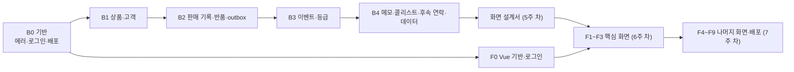

# 개발 계획 (백엔드 · 프론트엔드)

> 작성일: 2026-10-18 · 상태: 초안 · 기준 문서: [project-plan.md](project-plan.md), [01](01-requirements.md) ~ [04](04-architecture.md), [decisions.md](decisions.md)
> 프로젝트 계획서의 주차별 일정을 **PR 하나 단위의 작업**으로 쪼갠다. 작업 ID(B·F)는 브랜치·PR 이름과 PR 설명에 쓴다. 시간은 추정이고 1주 차 끝(10/21)에 다시 계산한다.

## 1. 작업 원칙

- **한 작업 = 한 PR**. 브랜치 이름은 `feat/B1-1-product`처럼 작업 ID를 넣는다. PR 설명에는 요구사항 ID와 테스트 결과를 적는다 (CLAUDE.md).
- **완료 기준**: ① 표의 "완료 기준"이 동작한다 ② 표의 테스트가 PR의 CI에서 통과한다 ③ 바뀐 규칙이 있으면 문서(01~04, ADR)를 같은 PR에서 고쳤다.
- **순서**: 백엔드 API를 먼저 만들고 Swagger로 확인한 뒤(1~5주 차), 화면을 만든다(6~7주 차). 단, 배포 문제를 일찍 찾기 위해 Vue 뼈대와 로그인 화면은 앞당길 수 있다 (F0).
- **직접 짤 것**: 등급 계산·상태 전이, 이벤트 처리, 금액·환불 계산, 엑셀 검증은 학습 목표라 직접 쓴다. AI는 설명·검토·막힌 곳 풀기에 쓴다.
- **지금 상태 (10/18)**: 백엔드 뼈대, 로컬 MariaDB, `schema.sql`(테이블 21개), 4개 모듈의 엔티티까지 `main`에 있다. 컨트롤러·서비스·리포지토리와 테스트는 아직 없다.

## 2. 백엔드 작업

### B0. 기반 (1주 차, 10/15 ~ 10/21)

| ID | 작업 | 요구사항 | 할 일 | 완료 기준 | 테스트 | 추정 |
| --- | --- | --- | --- | --- | --- | --- |
| B0-1 | CI·PR 규칙 | - | PR마다 `./gradlew test`(임시 MariaDB), PR 양식, CLAUDE.md 규칙 | PR의 backend-ci 통과 | 기존 contextLoads | 준비됨 (`chore/backend-ci`) |
| B0-2 | 공통 응답·에러 | 03 1장·5장, NFR-12 | 에러 코드 enum(03 5장 전체), 에러 응답 record(`code`, `message`, `fieldErrors`, `details`, `traceId`), 전역 예외 처리, 요청마다 traceId, 목록 응답 record, `/api/v1` 접두사, 시간을 `+09:00` 포함 ISO로, springdoc(`/swagger-ui`) | 없는 주소·잘못된 입력에 정해진 에러 형식, Swagger 열림 | 예외별 응답 형식 (웹 계층 테스트) | 3h |
| B0-3 | 로그인·권한 | AUTH-01·02, 03 2장 | Spring Security, jjwt, BCrypt, JWT 발급·검증 필터(Access 30분, Refresh 14일), `/auth/login`·`/auth/refresh`·`GET /me`, 역할별 접근(STAFF·MANAGER·KIOSK), 401·403도 같은 에러 형식, 비활성 계정 거절, 기본 데이터(매장·등급 기준·후속 연락 단계는 SQL, 계정은 앱 시작 코드 + 환경변수 비밀번호, ADR-019), Testcontainers 설정(ADR-017) | Swagger로 로그인 → 토큰으로 `/me` | Repository·Service·Controller 층별로: 로그인 성공·실패, 비활성 거절, 역할별 접근, 토큰 만료 | 6h |
| B0-4 | 무료 배포 확인 | NFR-13, ADR-013 | Dockerfile(빌드 단계 + Java 21 실행 단계), 환경변수, 무료 호스팅과 DB 선택, 배포 | 외부 주소 `/actuator/health`가 `UP`, 잠드는지 확인 | 배포 후 헬스 체크 | 3h |

### B1. 상품 · 고객 (2주 차, 10/22 ~ 10/28)

| ID | 작업 | 요구사항 | 할 일 | 완료 기준 | 테스트 | 추정 |
| --- | --- | --- | --- | --- | --- | --- |
| B1-1 | 상품 등록·조회 | PRD-01 | 상품 등록·수정·검색·상세, 색상 × 사이즈로 SKU 만들기(색상 없으면 `''`), 품목·대상별 사이즈 규칙(대상 없으면 전체 허용값), `GET /public/sizes`, 판매 모듈이 쓸 `product.api` | Swagger로 등록 → 검색 → 상세 | 사이즈 규칙(경계값), 품번 중복 409 | 3h |
| B1-2 | 상품 엑셀 | PRD-02, ADR-015 | Apache POI, 엑셀 폼 만들기(드롭다운, 예시 1행, 작성 방법 시트), 올린 파일 읽기, 행별 검사, 전부 맞을 때만 한 트랜잭션 저장, 최대 1,000행 | 폼 내려받기 → 채워 올리기 → 상품 생성, 틀린 행은 행 번호와 이유 | 폼 만들기 → 읽기 왕복, 틀린 행 오류 목록 | 4h |
| B1-3 | 고객 등록·중복 확인 | REG-01·04·05·06, BR-01·08, NFR-04 | 전화번호 정규화(E.164, 직접 구현, ADR-019), 전화번호·상세주소 암호화, HMAC 해시·뒷자리 4개, 동의 시각 저장, 성별별 사이즈 규칙, 외국인 이름 규칙, 직원 등록 `POST /customers`(중복이면 409와 기존 고객), 고객 요약 행 생성 | Swagger로 등록, 같은 번호는 409 | 정규화, 암호화 왕복, 중복 확인, 동의 없으면 400 | 5h |
| B1-4 | 키오스크·QR 등록 | REG-02·03, NFR-04a | `/kiosk/registrations`(매장은 토큰에서), `/public/join-info`, `/public/registrations`(기존 번호도 같은 응답), 직원 코드 규칙, IP당 분당 5회 제한, 매장·직원 QR 이미지 | 공개 등록 6번째 요청이 429 | 같은 응답, 요청 수 제한, 키오스크 권한 | 4h |
| B1-5 | 고객 검색·상세·수정 | CUS-01·02·04, NFR-05, ADR-018 | MyBatis 설정과 고객 검색 목록 매퍼, 이름 부분 검색 + 뒷자리, 목록은 마스킹 번호, 상세(요약·등급·근거·할인율 안내), 상세주소는 `include=address`일 때만, 수정(번호 변경 시 중복 확인, 담당 직원, 수신 동의) | 검색 → 상세 → 수정 | 마스킹, 번호 변경 중복 409, **SQL 경계·import 경계 테스트** | 5.5h |
| B1-6 | 가족 구성원 | CUS-05, BR-13 | 구성원 추가·수정·삭제·목록, 관계 enum, 자녀 아동 사이즈, 판매 모듈이 착용자를 확인할 `customer.api` | Swagger로 구성원 관리 | 자녀 사이즈, 다른 고객의 구성원 404 | 3h |

### B2. 판매 기록 (3주 차, 10/29 ~ 11/04)

| ID | 작업 | 요구사항 | 할 일 | 완료 기준 | 테스트 | 추정 |
| --- | --- | --- | --- | --- | --- | --- |
| B2-1 | 판매 기록 | SAL-01·04, BR-10·12, ADR-006·014 | `Idempotency-Key`와 요청 본문 해시, 영수증 번호(매장·날짜 행 잠금 후 +1), 매장은 토큰에서(`STORE_REQUIRED`), 라인은 SKU(스냅샷) 또는 직접 입력, 결제 금액 그대로 기록, 판매 시각 규칙(오늘·지금보다 이른 시각, `seed`는 과거 허용), 판매 당시 등급, 착용자 확인, 응대 메모, **같은 트랜잭션에서 outbox 기록** | 같은 키로 두 번 보내면 판매 1건, 두 번째는 200 | **통합 테스트(Testcontainers)**: 중복 요청, 동시 요청, 영수증 번호 동시 발급 | 5h |
| B2-2 | 판매 내역·구매이력 | SAL-05, CUS-03 | `GET /sales`(본사 계정은 매장 지정), 영수증 상세(정가·결제 금액·반품), `GET /customers/{id}/purchases`(판매 모듈이 제공) | 판매 후 내역과 고객 구매이력에 보임 | 매장 필터, 페이지 | 2h |
| B2-3 | 반품 | SAL-03, BR-11·12 | 라인별 반품 수량, 남은 수량 초과 409, 환불 금액(마지막 수량은 남은 금액 전부), 판매 상태 변경, 반품도 `Idempotency-Key`, outbox `SALE_RETURNED` | 3개를 1개씩 반품하면 33·33·34원 | 환불 계산 단위 테스트, 중복 반품 | 3h |
| B2-4 | outbox 발행기 | BR-06, ADR-002·007·012 | 1초마다 `PENDING`을 오래된 순으로 읽기, 같은 판매의 앞 이벤트가 남았으면 건너뛰기, 공통 형식 `OutboxMessage`로 Spring 이벤트 발행, 성공하면 `PUBLISHED`, 실패하면 재시도·10회 넘으면 `FAILED` | 판매 저장 1초 뒤 `PUBLISHED` | 순서 보장, 재시도·FAILED | 3h |

### B3. 고객관리 이벤트 · 등급 (4주 차, 11/05 ~ 11/11)

| ID | 작업 | 요구사항 | 할 일 | 완료 기준 | 테스트 | 추정 |
| --- | --- | --- | --- | --- | --- | --- |
| B3-1 | 이벤트 받기·중복 처리 | NFR-03, 03 6장 | `OutboxMessage`를 종류로 골라 받기, JSON을 고객 모듈 record로 읽기, `processed_event`로 중복 건너뛰기, 비회원 건너뛰기, 구매 기록 쌓기·반품 반영, 응대 메모 저장 | 판매 후 고객 상세에 구매 반영 | **같은 이벤트 두 번 → 결과 한 번** | 3h |
| B3-2 | 등급 계산기 | GRD-01, BR-02·03·04, NFR-09·10 | 기간(시작·끝)을 받는 계산, 시즌 구간(6월 1일 0시 경계), 티켓 수(전부 반품 제외), 순구매금액, 구간별 점수(이상 `>=`), 등급 컷 순서로 등급 결정. 순수 자바 클래스로 만든다 | 데모 기준값으로 예시 고객 등급이 맞음 | **경계값 단위 테스트**, 엑셀 툴 기준(36개월)으로 가상 고객 20명 비교 | 4h |
| B3-3 | 등급 상태 바꾸기 | GRD-02·03·06, BR-05, ADR-004·020 | `customer_summary` 실적 컬럼 이름 바꾸기(`*_12m` → `season_*`, `schema.sql`·엔티티), 판매 → 즉시 승급(이번 시즌 누적), 반품 → `max(실적 기준, 확정)`, 등급 이력과 사유, 등급 기준 새 버전 등록 → 전체 재계산(승급만 즉시) | 판매로 승급, 반품으로 승급 취소 | 승급·반품 취소·기준 변경 시나리오 (NFR-10a) | 4h |
| B3-4 | 정기 산정 | GRD-05, BR-05, ADR-020 | 연 정기 산정(6월 1일 새벽: 막 끝난 시즌 실적으로 확정 → 새 시즌 기준으로 집계 다시 계산), 수동 실행 API, 등급 기준 조회·버전 목록 | 수동 실행으로 정기 강등 확인 | 정기 강등, 시즌 경계(5/31 23:59와 6/1 00:00) | 2h |

### B4. 메모 · 콜리스트 · 후속 연락 · 데이터 (5주 차, 11/12 ~ 11/18)

| ID | 작업 | 요구사항 | 할 일 | 완료 기준 | 테스트 | 추정 |
| --- | --- | --- | --- | --- | --- | --- |
| B4-1 | 상담 메모 | MEM-01~03, CAL-02 | 메모 작성·목록·수정·삭제(본인, MANAGER는 전체), 연락 결과(`callResult`) | 메모 CRUD | 남의 메모 수정 403 | 2h |
| B4-2 | 콜리스트 | CAL-01, BR-09, ADR-018 | MyBatis 동적 SQL(`<if>`)로 담당 직원·최소 등급(컷 순서)·미방문 일수(구매 없으면 가입일)·대상·품목·가족 관계 필터, 오래된 방문 순, 홍보 연락 가능 표시 | 기본값(나, D 이상, 90일)으로 목록 | 필터 조합, 구매 없는 고객 | 3h |
| B4-3 | 후속 연락 | CAL-06·07, BR-14, ADR-016 | 단계 기본 3개, 이벤트 처리 때 할 일 만들기(받는 사람, 이전 할 일 `REPLACED`), 전부 반품이면 취소, 오늘 할 일, 완료(연락 메모 생성)·건너뛰기, 단계 설정 조회·저장(MANAGER) | 판매 저장 → 할 일 3개 → 2일 뒤 오늘 할 일에 나옴 | 만기일 계산(2달 달력 기준), 대체·취소, 홍보 단계 표시 | 5h |
| B4-4 | 더미 판매 생성기 | ING-01 | `seed` 프로필에서 매장·직원·상품·고객과 N개월치 판매를 판매 API로 생성, 끝나면 정기 산정 1회 | 데모 데이터로 등급이 골고루 나옴 | 생성 후 이벤트 전부 처리 | 3h |
| B4-5 | 성능 측정 | NFR-01·02 | 고객 5천·판매 2만 건으로 검색 p95, 판매 → 고객 반영 시간 측정, 결과를 문서에 기록 | 수치 기록 | 측정 스크립트 | 2h |
| B4-6 | 직원 관리 | ADM-01 | 직원·키오스크 계정 등록·수정·비활성화, 매장 목록 | Swagger로 직원 관리 | 비활성 후 로그인 거절 | 3h |

**백엔드 합계**: 약 80.5시간 (B0 12 + B1 24.5 + B2 13 + B3 13 + B4 18. 1주 차에 이미 쓴 기획·셋업 시간은 별도)

### 백엔드에서 정할 기술 결정

개발하면서 정하고, 정한 것은 ADR로 남긴다.

| 결정 | 선택지 | 추천 | 언제 |
| --- | --- | --- | --- |
| 전화번호 정규화 | Google libphonenumber / 직접 구현 | **결정: 직접 구현** (국내는 `+82`로, 외국은 `+`와 숫자만, ADR-019) | B1-3 |
| 개인정보 암호화 | AES-GCM 서비스 계층 / JPA 컨버터 | AES-GCM을 서비스 계층에서 (목록 조회 때 복호화하지 않게) | B1-3 |
| 요청 수 제한 | 메모리 직접 구현 / Bucket4j | **결정: 직접 구현** (서버 1개, IP당 분당 5회, ADR-019) | B1-4 |
| QR 이미지 | ZXing / 외부 API | **결정: ZXing** (ADR-019) | B1-4 |
| 기본 데이터 | SQL 파일 / 앱 시작 코드 | **결정**: 매장·등급 기준 v1·후속 연락 3단계는 SQL, 계정은 앱 시작 코드(비밀번호는 환경변수), 데모 대량 데이터는 `seed` 프로필 코드(B4-4) (ADR-019) | B0-3 |
| 조회 방식 | JPA Specification / QueryDSL / MyBatis | **결정: MyBatis** (목록·검색·집계 조회만, 쓰기는 JPA, 경계는 테스트로 검사, ADR-018) | B1-5 |
| 테스트 방식·DB | H2 / CI의 임시 MariaDB / Testcontainers | **결정**: CONK 방식(TDD 안쪽부터, 층별 테스트) + Testcontainers MariaDB, 첫 DB 테스트부터 (ADR-017) | B0-3 |

## 3. 프론트엔드

### 구조

```
frontend/
├─ src/
│  ├─ api/          axios 인스턴스(`/api/v1`, 토큰 붙이기, 401이면 재발급 후 다시 요청, 에러 형식 처리)
│  ├─ stores/       Pinia (로그인 사용자, 토큰)
│  ├─ router/       화면 경로, 역할별 접근, 키오스크 모드
│  ├─ pages/        화면 10개
│  ├─ components/   고객 찾기, 상품 고르기, 사이즈 선택, 저장 확인 창, 등급 배지, 마스킹 번호
│  ├─ composables/  중복 요청 키(화면 열 때 UUID), 페이지 넘기기
│  └─ utils/        금액·날짜·전화번호 표시, enum 한글 이름
└─ vite.config     개발 중 `/api` → localhost:8080
```

- 빌드 결과는 Spring Boot의 정적 파일로 들어가 서버 1개로 배포한다 (ADR-013). 화면 주소로 바로 들어와도 `index.html`을 돌려준다.
- 화면 공통 규칙: 폰 360px 폭 먼저(NFR-08), 터치 영역 44px 이상, 검색 → 상세 터치 2번, 금액은 `774,060원`, API 에러의 `message`·`fieldErrors`를 그대로 보여준다.

### 작업

| ID | 작업 | 화면·요구사항 | 할 일 | 완료 기준 | 주차 | 추정 |
| --- | --- | --- | --- | --- | --- | --- |
| F0 | 기반 + 로그인 | 로그인, AUTH-01 | Vite·Vue Router·Pinia·axios, 레이아웃(폰은 하단 메뉴, PC는 옆 메뉴), 역할별 메뉴, 로그인 화면, 토큰 재발급, 빌드 → Spring Boot 정적 파일 연결 | 배포 주소에서 로그인 → 메인 | 1주 차(앞당김) 또는 6주 차 | 3h |
| F1 | 판매 기록 | SAL-01·04, BR-10·12, NFR-08a | 고객 찾기(없으면 바로 등록) → 상품 고르기(검색·최근 상품) 또는 직접 입력 → 색상·사이즈·수량 → 결제 금액(정가 × 수량 × (1 − 등급 할인율) 기본값, 등급 할인 안내) → 착용자 → 시각(기본 지금) → 메모 → 저장 확인 창 → "○○님 구매이력이 저장되었습니다" | 폰에서 30초 안에 1건 기록 | 6주 차 | 5h |
| F2 | 고객 검색·상세 | CUS-01~05, GRD-03·06, MEM | 이름·뒷자리 검색, 목록(마스킹 번호·매장 단골 등급·마지막 방문), 상세 탭: 요약·등급 근거 / 구매이력 / 메모 / 가족 / 후속 연락 / 프로필 수정 | 검색 → 상세 터치 2번 | 6주 차 | 4h |
| F3 | 오늘 할 일 · 콜리스트 | CAL-01·02·06 | 오늘 할 일(이유, 밀린 날짜, 홍보 불가 표시), 연락 결과 기록 창, 건너뛰기, 콜리스트 필터 | 오늘 할 일 → 연락 결과 → 목록에서 빠짐 | 6주 차 | 3h |
| F4 | 직원 고객등록 | REG-01·04·05·06 | 등록 폼(성별에 따른 사이즈, 동의), 중복이면 기존 고객으로 이동, 판매 기록 중이면 돌아가기 | 판매 기록 → 신규 등록 → 판매로 복귀 | 7주 차 | 2h |
| F5 | 키오스크·QR 등록 폼 | REG-02·03 | F4 폼 재사용, 키오스크 모드(제출 후 초기화, 메뉴 없음), QR 공개 페이지(매장·직원 코드) | iPad 크기에서 등록 → 첫 화면 | 7주 차 | 3h |
| F6 | 판매 내역 · 반품 | SAL-03·05 | 날짜·매장별 목록, 영수증 상세(정가와 결제 금액), 반품 창(라인별 수량, 중복 요청 키) | 반품 후 상태 변경 | 7주 차 | 3h |
| F7 | 상품 관리 | PRD-01·02 | 목록·검색, 등록·수정(사이즈·색상 선택), 엑셀 폼 내려받기·올리기, 행별 오류 표 | 엑셀로 상품 등록 | 7주 차 | 4h |
| F8 | 관리 화면 | GRD-04·05, CAL-07, ADM-01 | 등급 기준(구간·점수·컷·할인율 안내), 후속 연락 단계 설정, 직원 관리와 QR 내려받기 (MANAGER만) | 설정 저장 | 7주 차 | 3h |
| F9 | 배포 마무리 | NFR-13 | 정적 파일 포함 빌드, 화면 경로 대응, 배포, 실제 폰 30초 측정 | 외부 주소에서 전체 흐름 | 7주 차 | 2h |

**프론트엔드 합계**: 약 32시간 (6주 차 15h, 7주 차 17h. F0을 1주 차로 당기면 6주 차가 그만큼 가벼워진다)

### 프론트엔드에서 정할 것

| 결정 | 선택지 | 추천 | 언제 |
| --- | --- | --- | --- |
| 언어 | JavaScript / TypeScript | JavaScript (이전 프로젝트와 같고 8주에 맞음). API 응답 모양은 JSDoc 주석으로 | F0 |
| UI 라이브러리 | Vant 4 (모바일) / Element Plus (PC, 써 봄) / 직접 CSS | Vant 4 (폰 360px 우선, NFR-08) | F0 |
| 테스트 | Vitest만 / Vitest + Playwright | Vitest로 금액 기본값·표시 함수, 시간이 남으면 Playwright로 판매 기록 1개 시나리오 | F1 |
| CI | 백엔드만 / 프론트 빌드·테스트 추가 | `frontend/**`가 바뀐 PR에 빌드·Vitest 추가 | F0 |

## 4. 순서와 의존 관계



- 화면은 해당 API가 Swagger에서 동작한 뒤에 만든다. 예: F1(판매 기록)은 B1-1·B1-3·B2-1 다음.
- 후속 연락(B4-3)은 이벤트 처리(B3-1) 안에서 할 일을 만들므로 B3 다음이다.
- 일정이 밀리면 project-plan.md 5장의 줄이는 순서대로 뺀다. 작업으로는 판매 착용자(B1-6 일부·F1 일부) → QR(B1-4 일부·F5 일부) → 상품 엑셀(B1-2·F7 일부) → 후속 연락 설정 화면(F8 일부) → 등급 기준 화면(F8 일부) → 직원 관리 화면(B4-6·F8 일부) 순이다.

## 5. 테스트 전략

| 종류 | 대상 | 도구 | 언제 돌리나 |
| --- | --- | --- | --- |
| 단위 (엔티티·계산기) | 등급 계산기, 환불 계산, 전화번호 정규화, 사이즈 규칙, 결제 금액 기본값, 엑셀 검증, 후속 연락 만기일 | JUnit 5 | 매 PR |
| Repository | 저장한 뒤 다시 조회해 확인, UNIQUE 제약, MyBatis 조회 SQL | `@DataJpaTest`·MyBatis 테스트 + Testcontainers MariaDB | 매 PR |
| Service | 업무 흐름과 예외 (DB 없이) | JUnit 5 + Mockito (`@Mock`, `@InjectMocks`) | 매 PR |
| 웹 계층 | 컨트롤러 입력 검증, 에러 형식, 역할별 접근, 상태 코드(201·400·401·403·404·409) | MockMvc (`@WebMvcTest`) | 매 PR |
| 통합 | 중복 요청·동시 요청, 영수증 번호, outbox → 이벤트 처리 → 등급·후속 연락, 등급 시나리오 | `@SpringBootTest` + MockMvc + Testcontainers MariaDB | 매 PR |
| 경계 | MyBatis SQL이 다른 모듈 테이블을 쓰는지, 다른 모듈 코드를 import하는지 | JUnit 5(XML 검사), ArchUnit | 매 PR |
| 프론트 | 금액·날짜 표시, 결제 금액 기본값 | Vitest | `frontend/**` PR |
| 측정 | 검색 p95, 반영 시간, 판매 기록 30초 | 측정 스크립트, 실제 폰 | 5주 차, 7주 차 |
