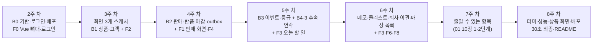

# 개발 계획 (백엔드 · 프론트엔드)

> 작성일: 2026-10-18 · 수정일: 2026-10-23 · 상태: 초안 · 기준 문서: [project-plan.md](project-plan.md), [01](01-requirements.md) ~ [04](04-architecture.md), [decisions.md](decisions.md)
> 프로젝트 계획서의 주차별 일정을 **PR 하나 단위의 작업**으로 쪼갠다. 작업 ID(B·F)는 브랜치·PR 이름과 PR 설명, 작업 시간 기록에 쓴다. 시간은 추정이고 11/04에 작업 시간 기록으로 다시 맞춘다.
> 변경: 2026-10-23 요구사항 점검 반영 — 기능마다 백엔드(TDD) → 화면 순서, "주" 칸, 새 작업(B2-5 교환, B2-6 기록 취소·하루 마감, B2-7 정정, B4-6 직원 관리·퇴사 이관, B4-7 매장 목록·상세, B4-8 매니저 메인·임시, B4-9 알림함, F6b·F8b·F9·F10), "먼저 쓸 실패 테스트" 칸, 5장 기능 하나를 만드는 순서.

## 1. 작업 원칙

- **한 작업 = 한 PR**. 브랜치 이름은 `feat/B1-1-product`처럼 작업 ID를 넣는다. PR 설명에는 요구사항 ID와 테스트 결과를 적는다 (CLAUDE.md).
- **완료 기준**: ① 표의 "완료 기준"이 동작한다 ② 표의 테스트가 PR의 CI에서 통과한다 ③ 바뀐 규칙이 있으면 문서(01~04, ADR)를 같은 PR에서 고쳤다.
- **순서**: 기능마다 백엔드 API를 TDD로 만들고(5장), Swagger로 확인한 뒤 **바로 그 화면까지** 붙인다. 주차는 project-plan.md 6장을 따르고, 표의 "주" 칸이 그 주다. 7주 차에는 줄일 수 있는 항목(01 10장 1·2단계)만 모았다.
- **직접 짤 것**: 등급 계산·상태 전이, 구매 건 티켓, 이벤트 처리, 금액·환불 계산, 이관 규칙, 엑셀 검증은 학습 목표라 직접 쓴다. AI는 설명·검토·막힌 곳 풀기에 쓴다.
- **지금 상태 (10/23)**: 백엔드 뼈대, 로컬 MariaDB, `schema.sql`(테이블 21개), 4개 모듈의 엔티티까지 `main`에 있다. 컨트롤러·서비스·리포지토리와 테스트는 아직 없다. 02-erd.md는 테이블 24개로 바뀌었고, `schema.sql`·엔티티는 표의 작업 때 맞춘다.

## 2. 백엔드 작업

### B0. 기반

| ID | 작업 | 요구사항 | 할 일 | 완료 기준 | 먼저 쓸 실패 테스트 | 주 | 추정 |
| --- | --- | --- | --- | --- | --- | --- | --- |
| B0-1 | CI·PR 규칙 | - | `chore/backend-ci`를 지금 `main`에 맞춰(CLAUDE.md에 PR 규칙 합치기) PR로 합친다 | PR의 backend-ci 통과 | 기존 contextLoads | 2 | 0.5h |
| B0-2 | 공통 응답·에러·로그 | 03 1장·5장, NFR-04b·12 | 에러 코드 enum(03 5장 전체), 에러 응답 record(`code`, `message`, `fieldErrors`, `details`, `traceId`), 전역 예외 처리, 요청마다 traceId, 요청 로그(메서드·경로·상태·시간·traceId만), 검증 에러는 필드 이름만 로그, 프로필별 SQL 값 로그(로컬만), 목록 응답 record, `/api/v1` 접두사, 시간을 `+09:00` 포함 ISO로, springdoc(`/swagger-ui`) | 없는 주소·잘못된 입력에 정해진 에러 형식, Swagger 열림 | 예외별 응답 형식, 검증 에러 로그에 값이 없음 | 2 | 4h |
| B0-3 | 로그인·권한 | AUTH-01~04, NFR-04c, ADR-023·025 | Spring Security, jjwt, BCrypt, JWT(Access 30분, Refresh 14일, 재발급 때 Refresh도 새로), `StaffRole` 바꾸기(HQ·STORE·MANAGER·SENIOR·JUNIOR·STAFF·KIOSK)와 `staff`의 `manager_slot`·`tokens_valid_after`, 요청마다 계정 활성·로그인 기준 시각 확인, `/auth/login`·`/auth/refresh`·`GET /me`·`PATCH /me/password`·`POST /auth/logout-all`, 비밀번호 규칙, 역할별 접근, 401·403도 같은 에러 형식, 시드(매장·매장 계정·본사·등급 기준·할인율·후속 연락 단계는 SQL, 계정 비밀번호는 환경변수, ADR-019), Testcontainers 설정(ADR-017) | Swagger로 로그인 → `/me`, 비활성화하면 다음 요청이 401 | 로그인 성공·실패, 비활성 즉시 차단, 기준 시각보다 먼저 발급된 토큰 거절, 역할별 접근, 비밀번호 규칙 위반·현재 비밀번호 틀림 | 2 | 7.5h |
| B0-4 | 무료 배포 확인 | NFR-13, ADR-013 | Dockerfile(빌드 단계 + Java 21 실행 단계), 환경변수, 무료 호스팅과 DB 선택, 배포, README "실행·배포" 절 | 외부 주소 `/actuator/health`가 `UP`, 잠드는지 확인 | 배포 후 헬스 체크 | 2 | 3h |

### B1. 상품 · 고객

| ID | 작업 | 요구사항 | 할 일 | 완료 기준 | 먼저 쓸 실패 테스트 | 주 | 추정 |
| --- | --- | --- | --- | --- | --- | --- | --- |
| B1-1 | 상품 등록·조회 | PRD-01 | 상품 등록·수정·검색·상세(매장 계정·본사), 색상 × 사이즈로 SKU 만들기(색상 없으면 `''`), 품목·대상별 사이즈 규칙(대상 없으면 전체 허용값), `GET /public/sizes`, 판매 모듈이 쓸 `product.api` | Swagger로 등록 → 검색 → 상세 | 사이즈 규칙(경계값), 품번 중복 409, 직원 계정 등록 403 | 3 | 3h |
| B1-2 | 상품 엑셀 | PRD-02, ADR-015 | Apache POI, 엑셀 폼 만들기(드롭다운, 예시 1행, 작성 방법 시트), 올린 파일 읽기, 행별 검사, 전부 맞을 때만 한 트랜잭션 저장, 최대 1,000행 | 폼 내려받기 → 채워 올리기 → 상품 생성, 틀린 행은 행 번호와 이유 | 폼 만들기 → 읽기 왕복, 틀린 행 오류 목록, 1,000행 시간(NFR-02a) | 7 (1단계) | 4h |
| B1-3 | 고객 등록·중복 확인 | REG-01·04·05·06, BR-01·08, NFR-04·04b | 전화번호 정규화(E.164, 직접 구현, ADR-019), 전화번호·상세주소 암호화, HMAC 해시·뒷자리 4개, 동의 시각 저장, 성별별 사이즈 규칙, 외국인 이름 규칙, 매장 계정의 `POST /customers`(중복이면 409와 기존 고객, `source=STORE`), 고객 요약 행 생성, 전화·주소 든 record의 `toString()` 가리기 | Swagger로 등록, 같은 번호는 409 | 정규화, 암호화 왕복, 중복 확인, 동의 없으면 400, **로그에 번호 평문 없음**(로그 캡처) | 3 | 5h |
| B1-4 | 키오스크·QR 등록 | REG-02·03, NFR-04a | `/kiosk/registrations`(매장은 토큰에서), `/public/join-info`, `/public/registrations`(기존 번호도 같은 응답), 직원 코드 규칙, IP당 분당 5회 제한, 매장·직원 QR 이미지(ZXing) | 공개 등록 6번째 요청이 429 | 같은 응답, 요청 수 제한, 키오스크 권한 | 7 (1단계) | 4h |
| B1-5 | 고객 검색·상세·수정 | CUS-01·02·04, NFR-05, ADR-018 | MyBatis 설정과 고객 검색 목록 매퍼, **이름 검색**(뒷자리 4개는 목록 표시), 상세(요약·등급·근거·임시/확정·할인율 안내), 상세주소는 `include=address`일 때만, 수정(매장 계정·본사, 번호 변경 시 중복 확인, 담당 직원, 수신 동의) | 검색 → 상세 → 수정 | 마스킹, 번호 변경 중복 409, **SQL 경계·import 경계 테스트** | 3 | 5.5h |
| B1-6 | 가족 구성원 | CUS-05, BR-13 | 구성원 추가·수정·삭제·목록, 관계 enum, 자녀 아동 사이즈, 판매 모듈이 착용자를 확인할 `customer.api` | Swagger로 구성원 관리 | 자녀 사이즈, 다른 고객의 구성원 404 | 7 (2단계) | 3h |

### B2. 판매

| ID | 작업 | 요구사항 | 할 일 | 완료 기준 | 먼저 쓸 실패 테스트 | 주 | 추정 |
| --- | --- | --- | --- | --- | --- | --- | --- |
| B2-1 | 판매 기록 | SAL-01·04, BR-10·12·16, ADR-006·014·023 | `Idempotency-Key`와 요청 본문 해시, 영수증 번호(매장·날짜 행 잠금 후 +1), 매장 계정만(`STORE_REQUIRED`), **판매 사원(`sellerStaffId`) 검증과 `recorded_by`**, 마감된 날 409, 라인은 SKU(스냅샷) 또는 직접 입력, 결제 금액 그대로 기록, 판매 시각 규칙(오늘·지금보다 이른 시각, `seed`는 과거 허용), 판매 당시 등급, 착용자 확인, 응대 메모, **같은 트랜잭션에서 outbox 기록** | 같은 키로 두 번 보내면 판매 1건, 두 번째는 200 | **통합 테스트(Testcontainers)**: 중복 요청, 동시 요청, 영수증 번호 동시 발급, 다른 매장 판매 사원 400, 마감된 날 409 | 4 | 5.5h |
| B2-2 | 판매 내역·구매이력 | SAL-05, CUS-03 | `GET /sales`(매장 계정은 자기 매장, 본사는 `storeId`), 영수증 상세(판매 사원, 정가·결제 금액, 반품·교환·기록 취소, 원 판매 연결), `GET /customers/{id}/purchases`(판매 모듈이 제공, 기록 취소 제외) | 판매 후 내역과 고객 구매이력에 보임 | 매장 필터, 페이지, 기록 취소 제외 | 6 | 2h |
| B2-3 | 반품 | SAL-03, BR-11·12 | 라인별 반품 수량(`kind=RETURN`), 남은 수량 초과 409, 환불 금액(마지막 수량은 남은 금액 전부), 판매 상태 변경, `Idempotency-Key`, 마감된 날 409, outbox `SALE_RETURNED` | 3개를 1개씩 반품하면 33·33·34원 | 환불 계산 단위 테스트, 중복 반품, 마감된 날 409 | 4 | 3h |
| B2-4 | outbox 발행기 | BR-06, ADR-002·007·012·022 | 1초마다 `PENDING`을 오래된 순으로 읽기, 같은 판매의 앞 이벤트가 남았으면 건너뛰기, 교환·정정 판매는 원 판매 ID를 `aggregate_id`로, 공통 형식 `OutboxMessage`로 Spring 이벤트 발행, 성공하면 `PUBLISHED`, 실패하면 재시도·10회 넘으면 `FAILED` | 판매 저장 1초 뒤 `PUBLISHED` | 순서 보장(교환 포함), 재시도·FAILED | 4 | 3h |
| B2-5 | 교환 | SAL-06, BR-17, ADR-022 | `POST /sales/{id}/exchanges`: `sale_return`(kind=EXCHANGE) + 새 `sale`(kind=EXCHANGE, `origin_sale_id`)를 한 트랜잭션으로, `extraPaid`, 이벤트 2개(원 판매 aggregate) | 교환 후 원 판매 상태와 새 영수증 | 남은 수량 초과 409, 추가 결제·차액 환불 금액, 이벤트 순서 | 7 (2단계) | 3.5h |
| B2-6 | 기록 취소·하루 마감 | SAL-07·08, BR-16, ADR-026 | `POST /sales/{id}/void`(kind=VOID, `VOIDED`), `POST /day-closes`, `GET`·`DELETE /stores/{storeId}/day-closes`, 판매한 날·마감 전 검사(`SALE_LOCKED`, `DAY_CLOSED`), `store_day_close` 테이블 | 마감 뒤 판매는 409, 본사가 다시 열면 기록됨 | 자정 경계, 마감·다시 열기 권한, 기록 취소 이벤트 | 4 | 2h |
| B2-7 | 판매 정정 | SAL-07, ADR-026 | `PUT /sales/{id}`: 기록 취소 + 원 판매 시각으로 `CORRECTION` 판매(새 영수증, `origin_sale_id`, 판매 사원 유지), 본사는 마감 뒤에도 | 정정 뒤 고객 반영이 새 내용으로 | 매장 계정 마감 뒤 409, 본사 지난 날짜 허용 | 7 (1단계) | 1.5h |

### B3. 고객관리 이벤트 · 등급

| ID | 작업 | 요구사항 | 할 일 | 완료 기준 | 먼저 쓸 실패 테스트 | 주 | 추정 |
| --- | --- | --- | --- | --- | --- | --- | --- |
| B3-1 | 이벤트 받기·구매 건 | NFR-03, 03 6장, ADR-022 | `OutboxMessage`를 종류로 골라 받기, JSON을 고객 모듈 record로 읽기, `processed_event`로 중복 건너뛰기, 비회원 건너뛰기, `kind`별 처리, 구매 건(`purchase_group_id`)·`counted_at` 정하기(추가 결제 교환은 새 구매 건, 원 판매당 교환 티켓 1개), VOID면 구매 건 제거, 응대 메모 저장, `customer_purchase` 컬럼 맞추기 | 판매 후 고객 상세에 구매 반영 | **같은 이벤트 두 번 → 결과 한 번**, 교환 티켓 시나리오 3개(01 BR-17 예시 포함) | 5 | 3.5h |
| B3-2 | 등급 계산기 | GRD-01, BR-02·03·04, NFR-09·10 | 기간(시작·끝)을 받는 계산, 시즌 구간(6월 1일 0시 경계), **구매 건 티켓**(상품이 남은 구매 건 수), 순구매금액, 구간별 점수(이상 `>=`), 등급 컷 순서로 등급 결정. 순수 자바 클래스로 만든다 | 데모 기준값으로 예시 고객 등급이 맞음 | **경계값 단위 테스트**, 엑셀 툴 기준(36개월)으로 가상 고객 20명 비교 | 5 | 4h |
| B3-3 | 등급 상태 바꾸기 | GRD-02·03·06, BR-05, ADR-004·020·021·027 | `customer_summary` 컬럼 이름(`*_12m` → `season_*`, `schema.sql`·엔티티), 판매 → 즉시 승급, 반품·교환·기록 취소 → `max(computed, confirmed)`, 6월에 지난 시즌 판매가 바뀌면 `confirmed`도 다시 계산, 등급 이력(사유 4종 + 시즌·티켓·금액·점수), `grade_discount` 테이블 | 판매로 승급, 반품으로 승급 취소, 6월에 지난 시즌 반품으로 임시 강등 | 시나리오(NFR-10a): 6/1·6/2·6/3 승급·환불, 임시 기간 재계산, 7/1 이후 확정 유지 | 5 | 4h |
| B3-4 | 정기 산정·기준 버전 | GRD-04·05, BR-05, ADR-021·027 | 6월 1일 새벽 + 6월 중 서버가 켜질 때 1회, `current = max(confirmed, computed)`, MyBatis 일괄 UPDATE, 수동 실행 API, `applies_from`으로 적용 중 기준 고르기, 기준 버전 등록(6월이면 정기 산정 다시 실행), 기준 조회·버전 목록, `PUT /grade-discounts` | 수동 실행으로 정기 강등, 두 번 실행해도 같음 | 재실행 결과 같음, 즉시 승급 유지, 시즌 경계, 적용 시작일 | 5 | 2.5h |

### B4. 고객관리 · 운영 · 데이터

| ID | 작업 | 요구사항 | 할 일 | 완료 기준 | 먼저 쓸 실패 테스트 | 주 | 추정 |
| --- | --- | --- | --- | --- | --- | --- | --- |
| B4-1 | 상담 메모 | MEM-01~03, CAL-02, ADR-029 | 메모 작성·목록·수정·삭제, 매장 계정은 작성 직원 필수, 연락 결과(`callResult`) + 채널(`channel`), 권한(작성 직원·매장 계정·본사) | 메모 CRUD | 남의 메모 수정 403, 매장 계정 작성 직원 누락 400 | 6 | 2h |
| B4-2 | 콜리스트 | CAL-01, BR-09, ADR-018 | MyBatis 동적 SQL(`<if>`): `scope`(MINE/STORE), `promoOnly`, 최소 등급(적용 중 등급, 컷 순서), 미방문 일수(구매 없으면 가입일), 대상·품목, 가족 관계, 오래된 방문 순, 홍보 연락 가능 표시 | 직원 기본값(나·D·90일), 매장 계정 기본값(이 매장 고객 전체·홍보 가능) | 필터 조합, 구매 없는 고객, "이 매장 고객" 정의 | 6 | 3h |
| B4-3 | 후속 연락 | CAL-06·07, BR-14, ADR-016 | 단계 기본 3개, 이벤트 처리 때 할 일 만들기(받는 사람: 담당 → 없거나 비활성이면 판매 사원 → 매장 계정이 맡은 고객이면 매장 계정), 교환은 만들지 않음, 기록 취소·전부 반품이면 취소, 정정은 원 시각으로 다시 만듦, 이전 할 일 `REPLACED`, 오늘 할 일(직원/매장), 완료(연락 메모·채널·직원)·건너뛰기, 단계 설정(본사) | 판매 저장 → 할 일 3개 → 2일 뒤 오늘 할 일에 나옴 | 만기일 계산(2달 달력 기준), 대체·취소, 받는 사람 규칙, 홍보 단계 표시 | 5 | 5h |
| B4-4 | 더미 판매 생성기 | ING-01 | `seed` 프로필에서 매장·계정·상품·고객과 N개월치 판매를 판매 API로 생성(판매 사원 지정), 끝나면 정기 산정 1회 | 데모 데이터로 등급이 골고루 나옴 | 생성 후 이벤트 전부 처리 | 8 | 3h |
| B4-5 | 성능 측정 | NFR-01·02·02a | 고객 5천·판매 2만 건으로 검색 p95, 판매 → 고객 반영 시간, 정기 산정 5천 명, 엑셀 1,000행, 이관 1,000명을 재고 문서에 기록 | 수치 기록 | 측정 스크립트 | 8 | 2h |
| B4-6 | 직원 관리·퇴사 이관 | ADM-01, AUTH-04, BR-15, ADR-024 | 계정 등록·수정(직급), 비활성화(직급 규칙 검사, 넘겨받을 사람, 매장 계정 새 비밀번호를 한 트랜잭션으로), `StaffDeactivated`·`StaffHandover` 이벤트 → 고객 모듈이 담당 고객·`OPEN` 할 일을 일괄 UPDATE(MyBatis), 담당 고객 넘기기, 비밀번호 다시 정하기, 직원·매장 QR API | 퇴사 시나리오: 고객 300명·할 일 18개 이관, 주인 없는 고객 0명 | 직급 규칙 위반 409, 이관이 실패하면 비활성화도 취소, 비활성 즉시 차단 | 6 | 4.5h |
| B4-7 | 매장 목록·상세 | ADM-03 | `GET /stores`, `GET /stores/{storeId}` 요약(오늘 판매 수, 마감 여부, 활성 직원 수), 매장 단위 권한 검사 | 본사로 매장 목록 → 상세 | 매장 계정이 다른 매장 경로를 부르면 403 | 6 | 1.5h |
| B4-8 | 매니저 메인·임시 | BR-15 | `manager_slot`, 자리 검사(409), 승격, 메인 퇴사는 매장 계정으로, 임시 퇴사는 메인으로 | 임시 → 메인 승격 | 자리 초과 409, 메인 퇴사 이관 대상 | 7 (1단계) | 1.5h |
| B4-9 | 직원 알림함 | CAL-09, ADR-029 | 알림 인터페이스 + 앱 안 알림함 구현(새 할 일, 담당 고객의 새 메모), 목록·읽음 | 할 일 생성 → 알림 1개 | 읽음 처리, 다른 직원 알림 403 | 7 (1단계) | 0.5h |

**백엔드 합계**: 약 97시간 (B0 15 + B1 24.5 + B2 20.5 + B3 14 + B4 23). 이 중 7주 차(1·2단계 후보) 몫이 약 17.5시간이다.

### 백엔드 기술 결정

| 결정 | 선택지 | 결정·추천 | 언제 |
| --- | --- | --- | --- |
| 전화번호 정규화 | Google libphonenumber / 직접 구현 | **결정: 직접 구현** (국내는 `+82`로, 외국은 `+`와 숫자만, ADR-019) | B1-3 |
| 개인정보 암호화 | AES-GCM 서비스 계층 / JPA 컨버터 | 추천: AES-GCM을 서비스 계층에서 (목록 조회 때 복호화하지 않게) | B1-3 |
| 요청 수 제한 | 메모리 직접 구현 / Bucket4j | **결정: 직접 구현** (서버 1개, IP당 분당 5회, ADR-019) | B1-4 |
| QR 이미지 | ZXing / 외부 API | **결정: ZXing** (ADR-019) | B1-4 |
| 기본 데이터 | SQL 파일 / 앱 시작 코드 | **결정**: 매장·매장 계정·본사 계정·등급 기준 v1·할인율·후속 연락 3단계는 SQL, 계정 비밀번호는 환경변수, 데모 대량 데이터는 `seed` 프로필 코드(B4-4) (ADR-019) | B0-3 |
| 조회 방식 | JPA Specification / QueryDSL / MyBatis | **결정: MyBatis** (목록·검색·집계 조회, 일괄 UPDATE는 정기 산정·이관만, 쓰기는 JPA, 경계는 테스트로 검사, ADR-018) | B1-5 |
| 테스트 방식·DB | H2 / CI의 임시 MariaDB / Testcontainers | **결정**: CONK 방식(TDD 안쪽부터, 층별 테스트) + Testcontainers MariaDB, 첫 DB 테스트부터 (ADR-017) | B0-3 |
| 퇴사 이관 전달 | outbox 공용화 / 같은 트랜잭션 Spring 이벤트 | **결정: 같은 트랜잭션 Spring 이벤트** (ADR-024) | B4-6 |
| 토큰 무효화 | Refresh 토큰 저장 / 로그인 기준 시각 | **결정: 로그인 기준 시각 + 요청마다 계정 확인** (ADR-025) | B0-3 |

## 3. 프론트엔드

### 구조

```
frontend/
├─ src/
│  ├─ api/          axios 인스턴스(`/api/v1`, 토큰 붙이기, 401이면 재발급 후 다시 요청, 에러 형식 처리)
│  ├─ stores/       Pinia (로그인 계정, 토큰, 직전에 고른 판매 사원). 고객 데이터는 저장하지 않음
│  ├─ router/       화면 경로, 역할별 접근과 첫 화면, 키오스크 모드
│  ├─ layouts/      PC 레이아웃(매장 계정 노트북, 본사), 폰 레이아웃(직원, 매장폰)
│  ├─ pages/        화면 10개 (01 6장)
│  ├─ components/   직원 고르기, 고객 찾기, 상품 고르기, 사이즈 선택, 저장 확인 창, 등급 배지(임시 표시), 마스킹 번호
│  ├─ composables/  중복 요청 키(화면 열 때 UUID), 페이지 넘기기
│  └─ utils/        금액·날짜·전화번호 표시, enum 한글 이름
└─ vite.config     개발 중 `/api` → localhost:8080
```

- 빌드 결과는 Spring Boot의 정적 파일로 들어가 서버 1개로 배포한다 (ADR-013). 화면 주소로 바로 들어와도 `index.html`을 돌려준다.
- 화면 공통 규칙: 매장 계정의 판매 화면은 노트북(PC) 기준, 직원 웹앱은 폰 360px 기준(NFR-08). 터치 영역 44px 이상, 검색 → 상세 터치 2번, 금액은 `774,060원`, API 에러의 `message`·`fieldErrors`를 그대로 보여준다. 화면 위에 로그인한 계정(매장 이름, 또는 이름·직급)을 항상 보여준다. 브라우저 저장소에는 토큰만 둔다 (NFR-04c).

### 작업

| ID | 작업 | 화면·요구사항 | 할 일 | 완료 기준 | 주 | 추정 |
| --- | --- | --- | --- | --- | --- | --- |
| F0 | 기반 + 로그인 | AUTH-01·03·04 | Vite·Vue Router·Pinia·axios, PC·폰 레이아웃(역할·화면 너비), 역할별 첫 화면, 로그인·로그아웃·모든 기기 로그아웃·비밀번호 바꾸기, 키오스크는 로그아웃 숨김, 토큰 재발급, 빌드 → Spring Boot 정적 파일 연결 | 배포 주소에서 로그인 → 역할별 첫 화면 | 2 | 3.5h |
| F1 | 판매 기록 (PC) | SAL-01·04, BR-10·12, NFR-08a | 판매 사원 고르기(직전 기본) → 고객 찾기(없으면 바로 등록) → 상품 고르기(검색·최근 상품) 또는 직접 입력 → 색상·사이즈·수량 → 결제 금액(정가 × 수량 × (1 − 등급 할인율) 기본값, 등급 할인 안내) → 착용자 → 시각(기본 지금) → 메모 → 저장 확인 창(판매 사원 표시) → "○○님 구매이력이 저장되었습니다" | 노트북에서 30초 안에 1건 기록 (첫 측정) | 4 | 5h |
| F2 | 고객 검색·상세 | CUS-01~04, GRD-03·06, MEM | 이름 검색, 목록(뒷자리·매장 단골 등급·마지막 방문), 상세 탭: 요약·등급 근거(임시 표시, 지난 시즌 점수) / 구매이력 / 메모 / 후속 연락 / 프로필 수정. PC·폰 둘 다 | 검색 → 상세 터치 2번 | 3 | 4h |
| F2b | 가족 구성원 탭 | CUS-05 | 구성원 목록·추가·수정·삭제 | 구성원 추가 → 판매 착용자로 고르기 | 7 (2단계) | 1h |
| F3 | 오늘 할 일 · 콜리스트 (폰) | CAL-01·02·06 | 오늘 할 일(내 할 일 / 매장 할 일 묶음, 이유, 밀린 날짜, 홍보 불가 표시), 연락 결과 창(직원·채널), 건너뛰기, 콜리스트 필터(직원: 내 담당 / 매장: 매장 공지용) | 오늘 할 일 → 연락 결과 → 목록에서 빠짐 | 5 (할 일)·6 (콜리스트) | 4h |
| F4 | 고객등록 (매장 계정) | REG-01·04·05·06 | 등록 폼(성별에 따른 사이즈, 동의), 중복이면 기존 고객으로 이동, 판매 기록 중이면 돌아가기 | 판매 기록 → 신규 등록 → 판매로 복귀 | 4 | 2h |
| F5 | 키오스크·QR 등록 폼 | REG-02·03 | F4 폼 재사용, 키오스크 모드(제출 후 초기화, 메뉴 없음), QR 공개 페이지(매장·직원 코드) | iPad 크기에서 등록 → 첫 화면 | 7 (1단계) | 3h |
| F6 | 판매 내역 · 반품 · 기록 취소 · 마감 | SAL-03·05·07·08 | 날짜별 목록, 영수증 상세(판매 사원, 정가와 결제 금액, 반품·교환·기록 취소), 반품 창(라인별 수량, 중복 요청 키), 기록 취소, "오늘 판매 마감" 버튼 | 반품·기록 취소 후 상태 변경, 마감 뒤 판매 막힘 | 6 | 3h |
| F6b | 교환 · 정정 | SAL-06·07 | 교환 창(반품 라인 + 새 상품, 차액 표시), 정정(판매 화면 재사용) | 교환 후 새 영수증 | 7 (교환 2단계·정정 1단계) | 1.5h |
| F7 | 상품 관리 | PRD-01·02 | 목록·검색·등록·수정(사이즈·색상 선택) 2.5h(8주 차), 엑셀 폼 내려받기·올리기·행별 오류 표 1.5h(7주 차, 1단계) | 화면에서 상품 등록 | 7·8 | 4h |
| F8 | 본사 매장 목록 · 상세 | ADM-03, SAL-07·08, AUTH-04 | 매장 목록, 매장 상세(판매 내역·정정, 마감 현황·다시 열기, 매장 계정 비밀번호) | 본사로 매장 → 마감 다시 열기 | 6 | 2h |
| F8b | 본사 직원 관리 탭 | ADM-01, BR-15 | 직원 목록·등록, 비활성화 창(넘겨받을 사람, 매장 계정 새 비밀번호), 승격, 담당 넘기기, 비밀번호, QR 내려받기 | 퇴사 처리 → 이관 결과 표시 | 7 (1단계, 그동안 Swagger) | 2h |
| F9 | 설정 화면 | GRD-04·05, CAL-07 | 등급 기준(적용 시작일 표시)·할인율, 후속 연락 단계 설정 | 설정 저장 | 7 (1단계) | 2h |
| F10 | 알림함 | CAL-09 | 배지, 목록, 읽음 | 새 할 일 → 배지 | 7 (1단계) | 0.5h |
| F11 | 배포 마무리 | NFR-13, NFR-08a | 정적 파일 포함 빌드, 화면 경로 대응, 배포, 실제 노트북 30초 최종 측정 | 외부 주소에서 전체 흐름 | 8 | 2h |

**프론트엔드 합계**: 약 39.5시간. 이 중 7주 차(1·2단계 후보) 몫이 약 13시간이다.

### 프론트엔드에서 정할 것

| 결정 | 선택지 | 추천 | 언제 |
| --- | --- | --- | --- |
| 언어 | JavaScript / TypeScript | JavaScript (이전 프로젝트와 같고 8주에 맞음). API 응답 모양은 JSDoc 주석으로 | F0 |
| UI 라이브러리 | Vant 4 (모바일) / Element Plus (PC, 써 봄) / 둘 다 / 직접 CSS | **다시 정함**: 핵심 판매 화면이 노트북(PC)이 되어 Vant 4만으로는 표·입력 화면이 어색하다. F0에서 PC는 Element Plus, 폰은 Vant 4로 나눌지, 하나 + 직접 CSS로 할지 정한다 | F0 |
| 테스트 | Vitest만 / Vitest + Playwright | Vitest로 금액 기본값·표시 함수, 시간이 남으면 Playwright로 판매 기록 1개 시나리오 | F1 |
| CI | 백엔드만 / 프론트 빌드·테스트 추가 | `frontend/**`가 바뀐 PR에 빌드·Vitest 추가 | F0 |
| 폰 앱처럼 쓰기 (PWA) | 지금 / 나중 | 나중 (직원 폰 푸시 CAL-08과 같이) | - |

## 4. 순서와 의존 관계



- 화면은 그 API가 Swagger에서 동작한 직후 같은 주에 만든다. 목데이터는 따로 만들지 않는다.
- 후속 연락(B4-3)은 이벤트 처리(B3-1) 안에서 할 일을 만들므로 B3과 같은 주에, B3-1 다음에 한다.
- 퇴사 이관(B4-6)은 후속 연락 할 일이 있어야 시나리오를 확인할 수 있어 6주 차다.
- 7주 차는 빠질 가능성이 낮은 것부터 한다: 가족(B1-6·F2b) → 교환(B2-5·F6b) → 알림함(B4-9·F10) → 착용자(B2-1 일부) → 메인/임시 매니저(B4-8) → 판매 정정(B2-7·F6b) → 설정·관리 화면(F8b·F9) → 상품 엑셀(B1-2·F7 일부) → 키오스크·QR(B1-4·F5). 시간이 모자라면 뒤에서부터 빠진다 (01 10장).

## 5. 테스트 전략

### 기능 하나를 만드는 순서 (TDD)

| 단계 | 할 일 | 커밋 |
| --- | --- | --- |
| ① 확인 | 요구사항(예: SAL-01, BR-12)과 API(03)를 읽고, 테스트할 경우를 먼저 적는다 (정상 → 경계 → 오류). 작업 표의 "먼저 쓸 실패 테스트" 칸이 출발점이다 | - |
| ② Repository | 실패 테스트(저장 후 다시 조회, UNIQUE 제약, MyBatis SQL) → 구현 → 통과 | `test:` → `feat:` |
| ③ Service | 실패 테스트(`@Mock`, 업무 규칙) → 구현 → 통과 | `test:` → `feat:` |
| ④ Controller | 실패 테스트(MockMvc: 201·400·401·403·404·409) → 구현 → 통과 | `test:` → `feat:` |
| ⑤ 통합 | 시나리오 테스트(동시 요청, 이벤트 처리, 등급·할 일 결과) | `test:` |
| ⑥ 정리 | 테스트가 모두 초록인 상태에서 코드 정리. 테스트를 구현에 맞춰 고치지 않는다 | `refactor:` |
| ⑦ 화면 | 계산 함수(결제 금액 기본값 등)는 Vitest 실패 테스트부터, 화면은 직접 써 보고 확인 | `test:` → `feat:` |
| ⑧ PR | CI(테스트) 통과를 확인하고 합친다. 작업 시간을 worklog에 적는다 | - |

테스트 이름은 `@DisplayName("한글 설명")` + 메서드 `should_동작_when_조건` (ADR-017).

### 종류별 대상

| 종류 | 대상 | 도구 | 언제 돌리나 |
| --- | --- | --- | --- |
| 단위 (엔티티·계산기) | 등급 계산기(시즌·임시 경계), 구매 건 티켓, 환불 계산, 전화번호 정규화, 사이즈 규칙, 결제 금액 기본값, 엑셀 검증, 후속 연락 만기일, 이관 직급 규칙 | JUnit 5 | 매 PR |
| Repository | 저장한 뒤 다시 조회해 확인, UNIQUE 제약, MyBatis 조회 SQL | `@DataJpaTest`·MyBatis 테스트 + Testcontainers MariaDB | 매 PR |
| Service | 업무 흐름과 예외 (DB 없이) | JUnit 5 + Mockito (`@Mock`, `@InjectMocks`) | 매 PR |
| 웹 계층 | 컨트롤러 입력 검증, 에러 형식, 역할별 접근, 상태 코드(201·400·401·403·404·409) | MockMvc (`@WebMvcTest`) | 매 PR |
| 통합 | 중복 요청·동시 요청, 영수증 번호, outbox → 이벤트 처리 → 등급·후속 연락, 교환·정정·기록 취소, 임시 기간, 퇴사 이관, 비활성 즉시 차단 | `@SpringBootTest` + MockMvc + Testcontainers MariaDB | 매 PR |
| 경계 | MyBatis SQL이 다른 모듈 테이블을 쓰는지, 다른 모듈 코드를 import하는지 | JUnit 5(XML 검사), ArchUnit | 매 PR |
| 로그 | 고객 등록·판매 뒤 로그에 번호·주소 평문이 없는지 | `OutputCaptureExtension` | 매 PR |
| 프론트 | 금액·날짜 표시, 결제 금액 기본값 | Vitest | `frontend/**` PR |
| 측정 | 판매 기록 30초(노트북), 검색 p95, 반영 시간, 정기 산정·엑셀·이관 시간 | 측정 스크립트, 실제 노트북 | 4주 차(30초 첫 측정), 8주 차 |
